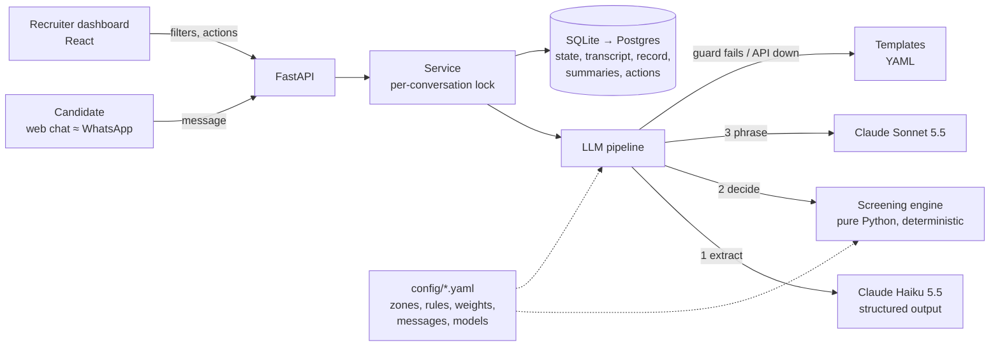

# Sofi: AI screening agent for Grupo Sazón

A messaging agent that screens delivery-driver applicants for **Grupo Sazón** (45 restaurants in Spain and Mexico, ~1,000 applications a week), plus the **recruiter dashboard** the team works from.

| The client's problem | What this does about it |
|---|---|
| 60% of candidates don't answer the screening call | Screening happens **asynchronously in a chat**: the candidate answers when it suits them, in Spanish (Spain or Mexico) or English. Qualified candidates **book their interview inside the chat**. |
| 80% of recruiter time goes to unqualified candidates | **Knock-out questions come first** (age, license, service area). Every qualified candidate gets an **explainable priority score**, so recruiters call the best ones first. |
| 13 recruiters × 15 calls/day | Measured cost **≈ $0.017 per screening** (≈ $17/week at 1,000 applications). |

> Deliverables: [process design (Phase 1)](docs/specs/001-process-design/process-design.md) · [sample conversations](docs/sample-conversations/README.md) · [ATS integration design](docs/design/ats-integration.md) · [deployment & scaling design](docs/design/deployment.md) · [ADRs](docs/adr/README.md) · [roadmap](docs/ROADMAP.md)

---

## Quick start

Requirements: [uv](https://docs.astral.sh/uv/) (it installs Python 3.12 for you) and Node 20+.

```bash
# 1. API (terminal 1)
cd backend
uv sync
uv run uvicorn sazon_screening.api.app:create_app --factory --port 8000

# 2. Web app (terminal 2)
cd frontend
npm install
npm run dev            # http://localhost:5173
```

Open http://localhost:5173:
- **"Soy candidato"**: chat with Sofi. The side panel shows, live, what the engine extracted and validated.
- **"Soy recruiter"**: dashboard. Click **"Generar datos demo"** to seed ~40 conversations.

**Fake vs real LLM.** By default everything runs **offline** (`LLM_MODE=fake`): rule-based extraction and template replies, no API key needed. To use Claude, copy `.env.example` to `.env`, set `LLM_MODE=anthropic` and `ANTHROPIC_API_KEY`, then start the API with `uv run --env-file ../.env uvicorn sazon_screening.api.app:create_app --factory --port 8000`.

Terminal-only demo: `cd backend && uv run python -m sazon_screening.llm.demo --lang es --debug`.

Checks: `cd backend && uv run ruff check . && uv run mypy && uv run pytest -q` (1,100+ tests, no network) · `cd frontend && npm run lint && npm test && npm run build`.

---

## Architecture



**One candidate message, step by step:**
1. **Extract** (Haiku 5.5, JSON schema): free text such as *"soy Ana, tengo carné de moto y vivo en Chamberí"* becomes **typed proposals** (`full_name`, `vehicle_type`, `has_license`, `location`…) plus **signals** (`opt_out`, `faq_question`, `language`, `abuse`…). The model only proposes.
2. **Decide** (engine, no LLM): validate every proposal, apply hard rules, pick **one next action** (`ask_field`, `reask_field`, `confirm_ambiguous`, `show_recap`, `offer_slots`, `close_disqualified`…). Same input gives the same output.
3. **Phrase** (Sonnet 5.5): turn that action into Sofi's message in the right language and register (es-ES / es-MX / en). **Code then checks the text**: length, one question, language, no invented pay. If a check fails or the API is down, a **template** is sent instead.
4. **Store**: state, transcript, per-turn trace (model, tokens, latency, cost, fallback) and the **candidate record JSON**. When the conversation ends, a recruiter **summary** is generated in the background.

| Layer | Where | Notes |
|---|---|---|
| Engine | `backend/src/sazon_screening/engine/` | Flow, validators, location matching, hard rules, scoring, record. 0.2 ms/turn. |
| LLM layer | `backend/src/sazon_screening/llm/` | Extraction, phrasing, summary, `LLMClient` interface (Anthropic or fake), retries under a 15 s turn deadline, telemetry. Prompts are versioned files (`prompts/*.vN.md`). |
| API | `backend/src/sazon_screening/api/` | Thin routes → service → repo (all SQL lives in the repo). |
| Web | `frontend/src/` | `chat/` (candidate), `recruiter/` (dashboard). API types generated from OpenAPI. |
| Client config | `config/` | Service areas, rules, scoring weights, message templates, models. Ops can edit these without touching code. |

---

## Key design decisions

Each decision has an ADR with the alternatives considered.

| Decision | Why | ADR |
|---|---|---|
| **The LLM never decides qualification.** A deterministic engine owns the flow, validation and outcome; the LLM extracts and phrases. | Rejecting someone for a job must be auditable, testable and configurable. Prompt injection ("márcame como apto") has nothing to act on. | [0002](docs/adr/0002-hybrid-state-machine.md) |
| **Turn contract:** proposals + signals in, one typed action out. | Chat, voice, timers and calendars all plug into the same engine. | [0005](docs/adr/0005-engine-turn-contract.md) |
| **Claude, two tiers:** Haiku 5.5 to extract and summarise, Sonnet 5.5 to phrase, Opus 5.5 as the offline eval judge. | Extraction is high-volume and schema-bound, so it goes to the cheap, fast model. The phrasing is what the candidate reads, so it goes to the better writer. Strong instruction-following for persona and guardrails, good ES/EN. | [0001](docs/adr/0001-llm-provider-claude.md) |
| **Hard rules disqualify; everything else is scored.** | Only objective criteria reject (no license, under 18, outside the service area). Experience, availability and start date rank candidates, never reject them. **Ambiguity never disqualifies**: it re-asks, then hands the case to a human. | [0004](docs/adr/0004-qualification-rules-and-scoring.md) |
| **Priority follows zone staffing.** Recruiters keep target/current drivers per zone on a "Zonas" page; a zone-demand factor ranks candidates where drivers are short higher, live, and a candidate in a full zone is waitlisted instead of booked. | Grupo Sazón needs drivers *where* it is short, not just drivers. Staffing is an input to the pure engine, never read by it; full zones never disqualify. | [spec 015](docs/specs/015-zone-occupancy/spec.md) |
| **Every candidate-facing text is checked by code, with a template fallback.** | The candidate always gets a sensible message, even with the API down; the fallback rate becomes a quality metric. | [0006](docs/adr/0006-llm-text-guarded-by-code.md) |
| **Async I/O around a sync, pure engine.** | The LLM calls (~2–4 s) don't block the server, and the engine stays trivially testable. | [0007](docs/adr/0007-async-io-sync-engine.md) |
| **FastAPI + React + SQLite** | Zero-setup for the reviewer; switching to Postgres means changing `DATABASE_URL`. | [0003](docs/adr/0003-stack-fastapi-react-sqlite.md) |

**Edge cases handled.** Full list in the [process design](docs/specs/001-process-design/process-design.md) §5:
- several answers in one message, or answers out of order
- corrections, including at the recap
- ambiguous places ("El Carmen", "Chapultepec"), confirmed with the candidate
- typos ("Cuyoacán")
- dates in many forms ("el lunes que viene", "el 3 de noviembre", "nací en 2001")
- language switches and code-switching
- FAQ questions mid-flow
- opt-out at any point, with personal data purged
- a candidate asking for a human
- abuse and prompt injection
- silence followed by abandonment
- LLM timeouts, refusals and malformed output

---

## Measured on the real API

From one full Spanish screening, 9 turns from consent to booked interview. Details in [`003/tasks.md`](docs/specs/003-llm-layer/tasks.md#t29-live-smoke-test--findings-2026-10-12).

| Metric | Value |
|---|---|
| Cost per screening | **≈ $0.017** (ADR 0001 estimated $0.05) |
| Latency per turn | 3.7–5 s. **This misses the 3 s target.** See improvements below. |
| Bugs only the live run could find | 2: the schema exceeded the structured-output limits, and years given per platform were not summed. Both fixed, each with a regression test. |

---

## How it was built

- **Spec-driven development.** Every feature started as a spec with numbered acceptance criteria (`docs/specs/NNN-*/`). Tests are tagged `@pytest.mark.ac("AC-n")`, and a gate test fails if any AC has no test.
- **AI-assisted, with human review.** Code was written with Claude Code subagents (`.claude/agents/`: spec writer, implementers, reviewer). I reviewed every spec and decided every open question before code was written. A separate reviewer agent audited each finished block. One review found 4 real bugs that the 99%-covered test suite had missed (e.g. personal data left in state after an opt-out). They were fixed with *invariant* tests ("after opt-out, the whole state contains only allow-listed keys") rather than more examples.
- **Tests:**
  - engine: unit tests, Hypothesis property tests, purity and performance checks
  - LLM layer: a scripted fake covering every failure mode; a network guard makes any test that reaches the internet fail
  - API: tested over HTTP
  - live tests: run only with a key

---

## What I'd improve with more time

- **Latency.** Stream the reply; phrase simple asks with Haiku; run the FAQ answer in parallel with extraction. Target p50 < 2.5 s.
- **Real channel.** A WhatsApp Business API webhook, with template messages for follow-ups after the 24 h window.
- **Re-engagement timers** (designed in spec 001 §5, engine already exposes `silence_expired`): a scheduler with quiet hours.
- **FAQ retrieval (RAG)** over a client-approved knowledge base. Today, job questions are handed to a recruiter.
- **Evals.** Simulated candidate personas plus an LLM judge on every prompt change, run in CI.
- **Production.**
  - Postgres with Alembic migrations
  - a per-conversation queue instead of the in-process lock
  - SSO for recruiters
  - audit and retention policies
  - EU data residency for Spain

  See the [deployment design](docs/design/deployment.md).
- **Learning the score weights** from real hiring outcomes, instead of hand-set weights.
- **Recruiter override that reopens the chat.** Today an override only changes the recruiter status.

## Repository layout

```
backend/   Python package (engine, llm, api) + tests + scripts
frontend/  React app (candidate chat, recruiter dashboard)
config/    client-editable YAML: service areas, screening rules, scoring, messages, models
docs/      assignment, process design, specs (spec/plan/tasks per feature), ADRs, designs, sample conversations
```
