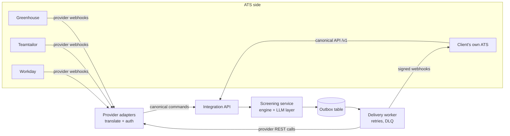

# ATS integration design

**Status:** Design only (roadmap item 14). Nothing in this document is built. · **Date:** 2026-10-12
**Related:** [process design](../specs/001-process-design/process-design.md), [spec 004 API](../specs/004-persistence-api/spec.md), [candidate record schema](../specs/002-screening-engine/candidate-record.schema.json), ADR 0002 / 0004.

## 1. Built today vs proposed

| Built (specs 002–006) | Proposed here |
|---|---|
| `CandidateRecord` v1 (JSON schema), statuses, score + factors, summary, transcript | A canonical integration API (`/v1/...`) and outbound webhook events |
| Conversations keyed by our UUID; candidate starts the chat in a simulated web chat | `ats_links` table: our id ↔ ATS candidate / application / job id |
| Recruiter actions `shortlist / reject / hire / override / note` (audit table) | Two-way sync of those actions with ATS stages |
| Opt-out purges the conversation and keeps a `do_not_contact` flag | Phone-keyed do-not-contact list + erasure propagated both ways |
| No phone number stored, no auth, no outbox | Encrypted contact store, HMAC/OAuth2, transactional outbox + delivery workers |

## 2. Shape: one canonical API + thin provider adapters



- The **canonical API** is the contract. A client with its own ATS integrates against it directly.
- An **adapter** per commercial ATS maps provider webhooks to canonical commands and canonical events to provider API calls (stage move, note, custom fields). Adapter-specific behaviour (which stage id, which custom field) is **YAML config per client**, like the rest of the business rules.
- Provider APIs differ a lot (Greenhouse Harvest and Teamtailor are REST/JSON with API keys or OAuth; Workday is tenant-specific and usually goes through an integration user). **Verify each against the provider's current docs before building.**

## 3. Data directions

| # | Direction | Trigger | What moves |
|---|---|---|---|
| 1 | ATS → us | New application for a driver job | Minimal contact + job/location → we start a WhatsApp screening (template message) |
| 2 | Us → ATS | Screening reaches an outcome (or abandons / opts out) | Status, outcome reason, score bucket, key fields, summary, interview slot, link to dashboard |
| 3 | ATS ↔ us | Recruiter moves the candidate (in the ATS **or** in our dashboard) | Stage / decision; the other side updates its view |
| 4 | Either way | Candidate withdraws, opts out or asks for erasure | Stop contact + delete/anonymise on both sides |

## 4. Endpoints we expose (inbound)

```yaml
# Excerpt: canonical integration API (OpenAPI 3.1 style)
paths:
  /v1/applications:            # direction 1
    post:
      summary: Register an application and start screening
      security: [oauth2_cc: [applications:write]]
      parameters:
        - {name: Idempotency-Key, in: header, required: true, schema: {type: string, maxLength: 128}}
      requestBody: {$ref: "#/components/schemas/ApplicationIn"}
      responses:
        "202": {description: Accepted, screening queued, content: {schema: {$ref: "#/components/schemas/ScreeningRef"}}}
        "200": {description: Duplicate Idempotency-Key, original response replayed}
        "409": {description: Phone on the do-not-contact list; no message sent}
        "422": {description: Invalid payload}
        "429": {description: Rate limited, honour Retry-After}
  /v1/screenings/{screening_id}:
    get:    {summary: Current status + record (same body as the screening.completed event)}
    delete: {summary: Erase the candidate (direction 4); 202, completes asynchronously}
  /v1/screenings/{screening_id}/decisions:   # direction 3, ATS → us
    post: {summary: "Recruiter decision: shortlist | reject | hire | withdraw | note"}
  /v1/webhooks/{provider}:     # provider adapters (Greenhouse, Teamtailor, ...)
    post: {summary: Raw provider webhook; verified with the provider's signature scheme}
```

| Method + path | Auth | Idempotent by | Notes |
|---|---|---|---|
| `POST /v1/applications` | OAuth2 client credentials (`applications:write`) | `Idempotency-Key` (24 h replay) + unique `(ats_provider, ats_application_id)` | Returns 202 fast; WhatsApp send happens in a worker |
| `GET /v1/screenings/{id}` | `screenings:read` | n/a | Polling fallback if webhooks fail |
| `DELETE /v1/screenings/{id}` | `screenings:erase` | Natural (delete twice = no-op) | Emits `candidate.erased` |
| `POST /v1/screenings/{id}/decisions` | `decisions:write` | `Idempotency-Key` | Maps to our `recruiter_actions`; `withdraw` closes the chat |
| `POST /v1/webhooks/{provider}` | Provider signature / shared secret | Provider event id | Adapter only |

**`ApplicationIn` example** (only what screening needs):

```json
{
  "ats": {"provider": "teamtailor", "candidate_id": "c_88213", "application_id": "a_51990", "job_id": "j_driver_mad"},
  "phone_e164": "+34612345678",
  "first_name": "Ana",
  "preferred_language": "es",
  "location_hint": {"country": "ES", "city": "madrid"},
  "consent": {"source": "ats_application_form", "privacy_notice_version": "2026-09", "accepted_at": "2026-10-12T09:14:03Z"},
  "applied_at": "2026-10-12T09:14:00Z"
}
```

- `location_hint.country` becomes the engine's `country_hint` (already accepted by `POST /api/conversations` and `TurnContextIn`); the candidate still confirms city/zone in chat.
- We do **not** accept CVs, email, date of birth or address: the screening does not need them.
- The ATS consent covers *processing the application*; Sofi's in-chat consent step (stage 0) still runs, because it covers being contacted on WhatsApp by an automated assistant.

## 5. Events we emit (outbound)

| Event | When | Contains |
|---|---|---|
| `screening.started` | First WhatsApp template accepted by the provider | refs, `status=in_progress` |
| `screening.completed` | Status becomes `interview_scheduled`, `qualified_unscheduled`, `disqualified` or `needs_review` | refs, record, summary, dashboard link |
| `screening.abandoned` | Last follow-up sent with no reply (needs spec 008 timers) | refs, `drop_off_stage` |
| `screening.updated` | A post-close correction or recruiter override changes the record | refs, record, `previous_status` |
| `candidate.opted_out` | Candidate opts out | refs only, **no PII** |
| `candidate.erased` | Erasure finished on our side | refs only |
| `decision.recorded` | Recruiter acts in **our** dashboard | refs, `action`, `note?`, `actor` |

**Envelope + `screening.completed` example** (the `record` is a real `CandidateRecord` v1):

```json
{
  "id": "evt_01JA7Q6W3H6V5T8X2M4N9P0R1S",
  "type": "screening.completed",
  "version": 1,
  "occurred_at": "2026-10-12T09:21:44Z",
  "sequence": 4,
  "screening_id": "6f1c2a9e-3b0d-4f55-9a7e-1d2c3b4a5f60",
  "ats": {"provider": "teamtailor", "candidate_id": "c_88213", "application_id": "a_51990"},
  "data": {
    "record": {
      "record_version": 1,
      "status": "interview_scheduled",
      "disqualification_reason": null,
      "needs_review_reasons": [],
      "score": {"score": 80, "bucket": "high", "max_score": 100, "factors": [
        {"field": "experience", "value": 3, "points": 15, "reason_code": "years_of_experience"},
        {"field": "experience", "value": ["glovo", "uber_eats"], "points": 20, "reason_code": "known_platforms"},
        {"field": "availability", "value": ["full_time"], "points": 15, "reason_code": "availability_breadth"},
        {"field": "schedule", "value": ["morning", "afternoon"], "points": 10, "reason_code": "schedule_flexibility"},
        {"field": "start_date", "value": "2026-10-13", "points": 20, "reason_code": "start_date_proximity"}]},
      "flags": [],
      "language": "es",
      "drop_off_stage": null,
      "selected_slot_id": "2026-10-14T10:00",
      "config_version": "2026-10-11.1",
      "consent": true,
      "fields": {
        "full_name": {"status": "valid", "value": "Ana López García"},
        "age": {"status": "valid", "value": {"is_adult": true, "age": null, "birth_year": null}},
        "vehicle_type": {"status": "valid", "value": "motorbike"},
        "has_license": {"status": "valid", "value": true},
        "location": {"status": "valid", "value": {"raw_text": "Malasaña", "country": "ES", "city": "madrid", "zone": "mad-centro", "in_service_area": true}},
        "availability": {"status": "valid", "value": ["full_time"]},
        "schedule": {"status": "valid", "value": ["morning", "afternoon"]},
        "experience": {"status": "valid", "value": {"years": 3, "platforms": ["glovo", "uber_eats"]}},
        "start_date": {"status": "valid", "value": "2026-10-13"}
      },
      "post_close_corrections": []
    },
    "summary_text": "**Ana López García** · Madrid (Centro) · moto + carné · 3 años (Glovo, Uber Eats) · jornada completa, mañana/tarde · empieza 13/10 · entrevista 14/10 10:00.",
    "dashboard_url": "https://screening.gruposazon.example/candidates/6f1c2a9e-..."
  }
}
```

- PII minimisation on the way out: `age` is sent as `is_adult` only (the engine stores an explicit age when given; the outbound mapper drops it). The transcript is **never** pushed; the ATS gets a link that requires recruiter login.
- `version` is the event schema version; `record_version` is the record's. Breaking changes bump them and run side by side for one release.

## 6. Mapping: our statuses and fields → typical ATS concepts

| Ours | Typical ATS stage / action | Notes |
|---|---|---|
| `in_progress` | Stage "AI screening" | Set on `screening.started` |
| `interview_scheduled` | Stage "Interview" + interview event at `selected_slot_id` (local time of the city) | Slot id is an ISO local date-time |
| `qualified_unscheduled` | Stage "Interview to schedule" | Recruiter books it |
| `needs_review` | Stage "Recruiter review" + tag per `needs_review_reasons` | e.g. `license_unclear`, `system_failure` |
| `disqualified` | **Default: stage "Not eligible – pending confirmation"**, not an automatic ATS rejection | See §8 (GDPR Art. 22). Auto-reject is a per-client flag |
| `abandoned` | Tag "No response (AI)" + `drop_off_stage`; stage unchanged | Recruiter may retry or archive |
| `opted_out` | "Candidate withdrew" + do-not-contact | Plus erasure if the client's policy says so |
| recruiter `shortlisted` / `rejected` / `hired` | Shortlist stage / reject with reason / hired | Two-way (direction 3) |
| recruiter `override` | Back to "Interview to schedule" | Our record keeps the agent's original outcome |

| Our field | ATS field (typical) | Notes |
|---|---|---|
| `fields.full_name` | first name / last name | Spanish names have two surnames: send the full string to a "full name" custom field too; never re-split blindly |
| `fields.location` (`city`, `zone`, `country`) | Location / "Preferred zone" custom field | Send config **ids** + display name |
| `vehicle_type`, `has_license` | Custom fields (select, boolean) | |
| `availability`, `schedule` | Multi-select custom fields | Enum values, language-neutral |
| `experience.years`, `experience.platforms` | Number + multi-select custom fields | Unknown platforms come as `other:<text>` |
| `start_date` | "Available from" date field | |
| `score.score`, `score.bucket` | Custom field + tag `priority:high` | Factors go into the note for explainability |
| `disqualification_reason` | Rejection reason (`no_license`, `out_of_area`, `under_age` → client's reason ids) | Mapped in YAML |
| Summary | Note / activity-feed entry | Default language from `llm.yaml` |
| Transcript | **Not sent**, link only | Minimisation |

## 7. Delivery guarantees

| Concern | Design |
|---|---|
| **Idempotency (inbound)** | `Idempotency-Key` header stored with the response for 24 h; plus a unique constraint on `(ats_provider, ats_application_id)` so a re-sent application never starts a second chat. Provider webhooks dedupe on the provider's event id. |
| **Idempotency (outbound)** | Every event has a stable `id`; receivers must dedupe on it. Provider calls are made idempotent by checking current ATS state before moving a stage ("already in Interview" = success). |
| **Outbox** | The event row is written in the **same DB transaction** as the turn that changed the status (transactional outbox), so a crash can't lose or invent an event. |
| **Retries** | Exponential backoff with full jitter: 30 s, 2 min, 10 min, 1 h, 6 h, then every 6 h up to 72 h. Retry on network errors, 408, 429 (respect `Retry-After`), 5xx. No retry on other 4xx: straight to dead-letter. |
| **Ordering** | Per-screening `sequence` number (monotonic). One delivery lane per screening, so events for one candidate are sent in order; different candidates go in parallel. Receivers ignore an event whose `sequence` is lower than one already applied. |
| **Dead-letter** | After the retry window, or on a non-retryable 4xx, the event goes to a DLQ table, an alert fires (§ deployment), and the dashboard shows a "not synced to ATS" badge. Ops can replay one event or a range after fixing the cause. |
| **Signatures** | Outbound: `X-Sazon-Signature: t=<unix>,v1=<hex HMAC-SHA256(secret, t + "." + body)>`. Receivers reject if `|now - t| > 5 min`. Two active secrets during rotation. Inbound provider webhooks: verify the provider's own scheme. |
| **Rate limits** | Inbound: token bucket per client, e.g. 20 req/s burst 100 (assumption), `429` + `Retry-After`. Outbound: per-provider token bucket configured below the provider's documented limit; when we hit `429`, the lane backs off without blocking other lanes. |
| **Reconciliation** | Nightly job compares ATS stage vs our status for screenings changed in the last 7 days and re-emits missing events. Covers silent webhook loss on either side. |

## 8. Auth, privacy and deletion

- **Auth to us:** OAuth2 client credentials (short-lived JWT, scopes per endpoint) for the canonical API; static API key + IP allow-list only as a fallback for ATSs that can't do OAuth. **Auth to the ATS:** whatever the provider supports (API key in a secrets manager, or OAuth2), scoped to the minimum (stage moves, notes, custom fields).
- **Legal basis and Art. 22:** an automatic rejection by an algorithm can be a "solely automated decision" with significant effect under GDPR Art. 22 (Spain) and is sensitive under Mexico's LFPDPPP. Hence `disqualified` lands in a confirmation stage by default, the reason is explicit (ADR 0004), and the override already exists in the dashboard. **The client's DPO decides** whether auto-reject is allowed.
- **Minimisation:** inbound accepts only phone, first name, job/location and consent metadata. Outbound sends fields the recruiter needs to act, never the raw transcript, explicit age or volunteered sensitive data. The record only holds typed fields (built); the transcript can still contain whatever the candidate typed, which is why it stays behind the dashboard login. Redacting volunteered sensitive data (ID numbers, health) from the transcript is planned in spec 007, not built.
- **Phone storage (new):** E.164 phone encrypted at rest in a `contacts` table, separate from the record. A keyed hash (HMAC of the phone) backs the do-not-contact list, so we can honour opt-outs without keeping the number readable.
- **Opt-out propagation:** candidate says stop → engine purges (built) → `candidate.opted_out` → ATS marks withdrawn / do-not-contact. ATS-side withdraw → `decision: withdraw` → we close the chat and send nothing more.
- **Erasure:** `DELETE /v1/screenings/{id}` or an ATS deletion webhook → delete contact, transcript, summaries, traces; keep an anonymised stub (status, dates, config version) for funnel analytics; emit `candidate.erased`. SLA well inside the legal one month (GDPR) / 20 working days (LFPDPPP ARCO response). Deletion is logged in the audit log without the deleted data.
- **Retention:** default 12 months for non-hired candidates, then auto-anonymise (assumption; client to confirm).

## 9. Main flow

```mermaid
sequenceDiagram
    autonumber
    participant ATS
    participant API as Integration API
    participant Q as Queue / workers
    participant WA as WhatsApp (Meta / Twilio)
    participant C as Candidate
    participant R as Recruiter
    ATS->>API: POST /v1/applications (Idempotency-Key, OAuth2)
    API->>API: dedupe, check do-not-contact, store contact + ats_link
    API-->>ATS: 202 {screening_id}
    API->>Q: enqueue start(screening_id)
    Q->>WA: approved template "Hola Ana, soy Sofi..." 
    Q->>API: outbox: screening.started
    API-->>ATS: screening.started (signed) → stage "AI screening"
    C->>WA: replies (opens the 24 h window)
    WA->>API: inbound webhook
    API->>Q: enqueue turn (per-conversation lane)
    Q->>Q: extract → engine step → phrase (+ guard)
    Q->>WA: Sofi's reply
    Note over C,Q: ~9–12 turns, one at a time per conversation
    Q->>API: status = interview_scheduled; outbox event in same tx
    API-->>ATS: screening.completed → stage "Interview" + note + fields
    R->>ATS: moves to "Hired" (or acts in our dashboard)
    ATS->>API: webhook / POST decisions {hire}
    API->>API: recruiter_actions += hire (audit)
```

## 10. Open questions for the client

1. **Which ATS** (and edition), and who owns the integration user and its permissions?
2. Does the ATS **start** the contact (direction 1), or do candidates still apply through a WhatsApp link / QR in the restaurants? Both can coexist; the second needs a "create application in ATS" call from us.
3. **Auto-reject or confirm?** May a `disqualified` result reject the application in the ATS automatically, or must a recruiter confirm (our default)?
4. Stage names/ids per job and per country; one pipeline for Spain and Mexico, or two?
5. Which custom fields exist (or may we create), and which ATS is the **system of record** for recruiter decisions when both sides change?
6. Retention period, erasure process and the DPO contact; is there a DPA in place with the ATS vendor and with us?
7. Does the ATS consent text cover WhatsApp contact by an automated assistant, or do we need our own notice (current design: both)?
8. Expected volume per hour at peak (job-board campaigns), so we can size rate limits.
9. Should interview slots come from the ATS's scheduling module instead of our slot provider (spec 010)?
