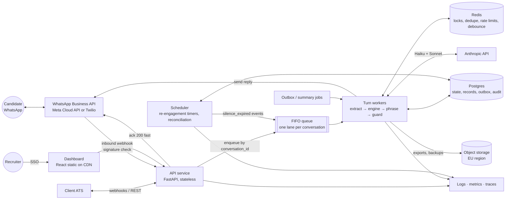

# Deployment, monitoring and scaling design

**Status:** Design only (roadmap item 14). Nothing in this document is deployed. · **Date:** 2026-10-12
**Related:** ADR 0001 (models, cost), 0003 (SQLite → Postgres path), 0006 (template fallback), 0007 (async I/O); [spec 004](../specs/004-persistence-api/spec.md) §6 known limits; [ATS integration](ats-integration.md); T29 live numbers in [spec 003 tasks](../specs/003-llm-layer/tasks.md).

> **Reading guide.** ✅ = built and tested today. 🔜 = proposed. **A#** = assumption, listed in §3 and to be checked with real traffic.

## 1. Target architecture

- **One region in the EU** (Spain's data is EU personal data; e.g. AWS eu-south-2 Madrid or eu-central-1). At ~1 turn/s (§3), multi-region active-active is not worth it; DR = Postgres point-in-time recovery + backups replicated to a second EU region.
- The **engine is unchanged**: it is a pure function (ADR 0005), so scaling is all about the I/O around it.
- **Per-conversation ordering:** a FIFO queue keyed by `conversation_id` (e.g. SQS FIFO `MessageGroupId`, or Redis Streams with a consumer per partition). Different candidates run in parallel; one candidate's messages never race. Timer events (`silence_expired`) go through **the same lane**, so a timer can't race a late reply. Belt and braces: the worker takes `SELECT … FOR UPDATE` on the conversation row (or a Postgres advisory lock) and checks a `version` column.
- **Debounce (🔜):** WhatsApp users send bursts ("hola" · "soy Ana" · "de Madrid"). The worker waits ~2 s for more messages in the lane and runs **one turn** on the joined text: fewer LLM calls, better extraction.

## 2. What changes from today

| Area | Today ✅ | Proposed 🔜 | Why |
|---|---|---|---|
| Database | SQLite (WAL), `create_all` at startup | Managed Postgres, **Alembic** migrations, JSON → JSONB, same SQLAlchemy models | Concurrency, backups/PITR, safe schema changes |
| Ordering | In-process `asyncio.Lock` per conversation (dict never pruned) | FIFO lane per conversation + row lock / advisory lock | Works across many instances |
| Background work | FastAPI `BackgroundTasks` for summaries | Worker queue with retries (summaries, outbox delivery, exports) | Survives restarts; retries are visible |
| Channel | Web chat, plus a WhatsApp webhook adapter (spec 016: signed webhook, dedupe, buttons, template after 24 h) tested on Meta's test number | Verified business number, approved templates per language, a queue in front of the webhook | Real channel at volume |
| Re-engagement | Scheduler loop inside the API process (spec 008): follow-ups with quiet hours per city timezone, claimed with a conditional UPDATE | Separate scheduler service or delayed queue with a DB lock | Works across many instances |
| Secrets | `.env` file | Secrets manager (Anthropic key, WhatsApp token, ATS creds, HMAC secrets), rotated | No secrets on disk |
| Recruiter auth | None | SSO (OIDC via the client's IdP), roles per country/location | PII behind login |
| Dev routes | Gated by `APP_ENV=dev` | Not deployed in prod at all | Smaller attack surface |
| Config | YAML files read at startup, version stamped on records/traces | Same files, shipped via deploy; per-location feature flags | Keep ops-editable rules (CLAUDE.md) |

## 3. Capacity maths (10K applications/week)

**Measured (T29, one live ES screening):** ≈ **$0.017 per screening**, 9 turns, **3.7–5 s per turn** (Sonnet phrasing dominates). One run only: treat as indicative.

| Assumption | Value |
|---|---|
| A1 Turns per screening | 11 (range 10–12; happy path measured 9; re-asks/FAQ add more) |
| A2 LLM calls per turn | 2 (Haiku extraction + Sonnet phrasing) + 1 Haiku summary per finished screening |
| A3 Tokens per turn | Extraction ~2K in / 200 out; phrasing ~1.5K in (≈80 % cached system prompt) / 80 out (ADR 0001 estimate, consistent with the measured cost) |
| A4 Arrival pattern | 85 % of applications 09:00–23:00 local, 7 days; ES and MX time zones are 7 h apart, which spreads load |
| A5 Peak hour | 2.5 × the mean active hour; job-board bursts up to 10 × for ~15 min |
| A6 Conversation wall time | ~10 min while active (candidate typing time dominates) |

| Quantity | Calculation | Result |
|---|---|---|
| Turns / week | 10,000 × 11 | **110K turns**, ~230K LLM calls |
| Mean active hour | 10,000 × 0.85 / (7 × 14 h) | ~90 screenings started / h |
| Peak hour | × 2.5 (A5), rounded up | **~250–300 / h → ~0.9 turns/s** |
| Burst | × 10 for 15 min | ~9 turns/s |
| Turns in flight (Little's law, 5 s/turn) | 0.9 × 5 / 9 × 5 | **~5 at peak, ~45 in a burst** |
| Open conversations | 300/h × 10 min | ~50 at peak |
| Anthropic RPM per model | 0.9 turns/s × 60 | ~55 RPM peak, ~550 RPM burst |
| Anthropic input tokens/min | Haiku 55 × 2K; Sonnet 55 × 1.5K | ~110K + ~80K ITPM peak (×10 in a burst) |
| Tokens / week | 110K × 3.5K in, 110K × 280 out | ~385M in (mostly cached), ~31M out |
| LLM cost / week | 110K turns × ~$0.0019 (measured rate) | **~$210** (planning figure **$250** = $0.025/screening) |
| DB writes | ~5 statements per turn | ~5 writes/s peak: trivial for a small Postgres |
| Storage | ~22 messages × ~4 KB (with trace) × 10K | ~1 GB/week → prune traces after 90 days |

**Reading it:** the load is small for the infrastructure (one async worker can hold dozens of in-flight turns, A7: verify in a load test) and the **real limit is Anthropic's rate limits during bursts**. Mitigations: check the org's tier limits in the Console before the 10K rollout and request an increase; cached prompt reads are cheaper and on current models generally do not count against input-token limits (verify for the tier); we **control the start rate** of ATS-initiated screenings, so bursts can be smoothed by throttling outbound templates; on `429` the existing retry loop (ADR 0007) backs off, and if the 15 s turn budget runs out the candidate gets the template reply (ADR 0006).

**Latency:** the measured 3.7–5 s misses the p50 < 3 s target. On WhatsApp a few seconds is acceptable if the candidate sees activity, so: mark-as-read + typing indicator immediately (where the API supports it), then try Haiku phrasing for simple `ask_field` actions as an A/B (§6). Streaming does not help: WhatsApp delivers whole messages.

## 4. Cost per week (estimates)

| Line | 1K / week | 10K / week | Basis |
|---|---|---|---|
| LLM (Anthropic) | $17–25 | $170–250 | Measured $0.017, planning $0.025 per screening |
| WhatsApp messages | $15–60 | $150–600 | **A8:** ~1.5 paid templates per candidate (start + follow-ups past 24 h) × $0.01–0.04; replies inside the 24 h customer-service window are free. **Verify the ES/MX rate card** (and Twilio's per-message fee if used). Near zero if candidates start the chat themselves (QR / click-to-WhatsApp) |
| Compute (API + workers + scheduler) | ~$15 | ~$35 | A9: 2 small containers → 3–4; scales on queue depth |
| Postgres (managed, HA at 10K) | ~$12 | ~$45 | A9 |
| Redis | ~$4 | ~$12 | A9 |
| Logs, metrics, traces | ~$12 | ~$30 | A9; PII-free logs keep volume low |
| Object storage, CDN | ~$1 | ~$2 | |
| **Total** | **~$75–130** | **~$440–975** | **~$0.08–0.13 → ~$0.04–0.10 per candidate** |

A9 = typical list prices of a mainstream cloud, rounded; WhatsApp is the biggest uncertainty. For scale: this replaces ~975 phone calls a week today.

## 5. Observability

**Logs:** JSON, one line per event, always with `conversation_id`, `turn_id`, `stage`, `action`, `prompt_version` (`llm.yaml` version), `model`, `latency_ms`, `cost_usd`, `fallback`. **Never message text at INFO** (PII); text lives only in the DB. Today ✅ every turn already produces a structured trace (models, latency, cost, extraction outcome, fallback reason) stored on the message; it just isn't shipped to a log pipeline yet.

**Traces:** OpenTelemetry spans webhook → queue wait → extraction → engine → phrasing → guard → send, so a slow turn shows *where* it was slow.

| Metric | Source | Target | Alert |
|---|---|---|---|
| Turn latency p50 / p95 | trace `latency_ms` ✅ | < 4 s / < 8 s | p95 > 10 s for 10 min (budget is 15 s) |
| Queue age (webhook → worker start) | queue | < 2 s | > 30 s for 5 min |
| Fallback rate | `messages.fallback` ✅ | < 2 % | > 5 % / 15 min warn; > 20 % page (likely API outage) |
| Extraction failure rate | trace `extraction.outcome` ✅ | < 1 % | > 3 % / 30 min |
| `needs_review` with `system_failure` | record ✅ | < 1 % | > 2 % / day |
| Cost per screening | `cost_usd` ✅ | ~$0.02 | 7-day mean > $0.04 |
| Completion rate, drop-off by stage, median duration | `/api/analytics` ✅ | > 70 %, < 5 min | completion < 60 % daily; any stage's drop-off share +50 % week on week |
| Anthropic 429 / 5xx rate | client telemetry | ~0 | > 1 % / 10 min |
| WhatsApp send failures, template rejections | channel adapter | ~0 | > 1 %; any template paused by Meta |
| ATS outbox DLQ size, sync lag | outbox | 0, < 5 min | DLQ > 0 → ticket; lag > 30 min |
| Recruiter override rate on `disqualified` | `recruiter_actions` ✅ | low | sudden rise = rule or extraction regression |

**LLM quality monitoring (🔜):** a nightly job samples 2 % of conversations plus **all** fallbacks and `needs_review` cases and scores them with the offline judge (Opus; prompts `judge_phrasing.v1` / `judge_summary.v1` exist, the live eval T31 is not run yet). Track judge means per prompt version; a drop of > 0.3 points blocks promotion. **Prompt A/B:** variant chosen by `hash(conversation_id)`; compare completion rate, fallback rate, judge score, latency and cost. The prompt/config version is already stamped on every trace and record ✅, so results are attributable.

## 6. Reliability

| Failure | Behaviour |
|---|---|
| Anthropic slow or down | ✅ Retry under the 15 s turn budget, then the deterministic template for that action/language/register (ADR 0006); repeated extraction failures → `needs_review` (verified live in T29). 🔜 A kill switch that forces template phrasing everywhere during an incident. |
| Worker crash mid-turn | 🔜 The queue redelivers; the turn is idempotent because the inbound WhatsApp message id is deduped (Redis + unique column) and state is saved in one transaction with the reply + outbox row. |
| Duplicate webhooks (Meta / Twilio retry) | 🔜 Dedupe on provider message id; always answer 200 fast and process async. |
| WhatsApp 24 h window | 🔜 Free-form replies only inside 24 h of the candidate's last message; follow-ups after that use pre-approved templates per language/register (es-ES, es-MX, en). Template approval is on the critical path of the pilot. |
| Postgres failover | Managed HA + PITR; workers retry on connection errors. |
| Bad config or prompt deploy | ✅ Config is validated at startup (refuses to start, naming the key). 🔜 Canary to one location first; rollback = previous version file. |

## 7. Security and compliance

- **PII:** phone (🔜 encrypted column), name, location, transcript. TLS everywhere, encryption at rest, recruiter access by SSO with roles per country/location; exports to object storage are signed, short-lived URLs.
- **Retention (A10, client to confirm):** traces 90 days; transcripts and records 12 months for non-hired candidates, then anonymised; anonymised funnel stats kept.
- **Right to erasure / opt-out:** ✅ opt-out purges the engine state and redacts the stored transcript, keeping only a `do_not_contact` flag. 🔜 erasure endpoint + propagation to the ATS ([ATS design §8](ats-integration.md#8-auth-privacy-and-deletion)); phone-hash do-not-contact list.
- **LLM provider:** API data is processed under Anthropic's commercial terms/DPA; if the client requires EU-only processing, run Claude through an EU region of AWS Bedrock or Google Vertex AI (availability of these model versions to verify). The `LLMClient` interface makes this a config change (ADR 0001). Consider a zero-data-retention agreement.
- **Prompt injection posture:** ✅ the LLM cannot change outcomes, scores or flow (ADR 0002); candidate text is delimited in prompts; every reply passes code checks (length, one question, language, no invented pay or currency, emoji limits) before sending (ADR 0006); injection test with the rules fake passes. 🔜 the live injection eval (T30) and spec 007 guardrails.
- **Audit log:** ✅ recruiter actions are append-only rows. 🔜 add who viewed/exported/erased which candidate (actor from SSO), config/prompt version changes, and kill-switch use.
- **Automated decisions:** disqualification reasons are explicit and overridable ✅; ATS auto-reject stays off unless the client's DPO approves (GDPR Art. 22).

## 8. Rollout plan

| Phase | Scope | Exit criteria |
|---|---|---|
| 0. Readiness (1–2 wk) | Postgres + Alembic, queue, WhatsApp adapter, templates approved, SSO, dashboards and alerts, load test at 10× peak | Load test p95 < 8 s; fallback < 2 % on the live eval set |
| 1. Pilot (2–4 wk) | **2 locations: one Madrid, one CDMX** (both registers); recruiters keep phone screening as a safety net for `needs_review` | Completion > 70 %, median < 5 min, recruiter override on `disqualified` < 5 %, no P1 incidents, recruiter feedback |
| 2. Expand | ~10 locations, ATS sync on | Same metrics hold; cost per screening within 25 % of plan |
| 3. All 45 | Re-engagement and ATS auto-stage moves per country | Weekly review of drop-off by stage |

- **Feature flags per location/country:** WhatsApp channel on, ATS sync, auto-reject (default off), re-engagement, Haiku-phrasing variant, template-only kill switch.
- **Prompt versioning:** ✅ prompts are versioned files and `llm.yaml` points to the active one (extraction moved v1 → v2 after T29). New versions go: offline eval → A/B on a slice → promote, with the version on every trace.

## 9. What I'd do with more time

1. Run the live evals (T30–T32): extraction accuracy, injection, phrasing judge, latency/cost over ≥ 50 turns, so §3 rests on more than one conversation.
2. Load test the queue + worker design with simulated candidates (spec 012 personas) at 10× peak.
3. Build the WhatsApp adapter against the Meta Cloud API sandbox, including templates and the 24 h window logic.
4. Message debounce and Haiku phrasing for simple asks, measured as an A/B on latency and quality.
5. Re-engagement scheduler (spec 008) with quiet hours and template follow-ups.
6. Learn score weights from hiring outcomes coming back from the ATS (ADR 0004 consequence).
7. Event-sourced turn inputs for full replay and audit (ADR 0005 alternative).
8. Cost guardrails: per-day budget alarm and an automatic switch to cheaper phrasing above it.
