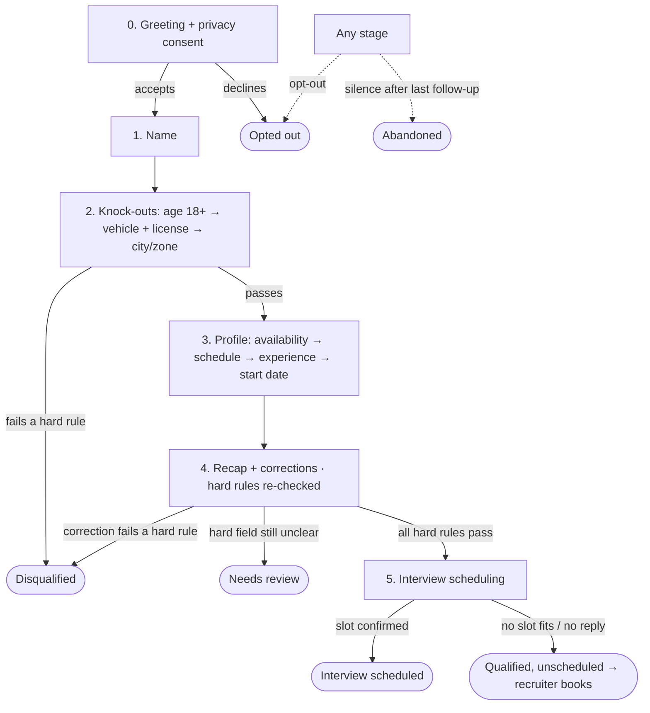

# Grupo Sazón — Delivery Driver Screening: Process Design

**Status:** Approved v2 · **Owner:** Gerard · **Date:** 2026-10-11 · Open questions for the client: [decisions.md](decisions.md)

## 1. Goal
**Today:** 13 recruiters × ~15 calls/day ≈ 975 calls/week to handle ~1,000 applications. 60% of those calls go unanswered, and 80% of the remaining time is spent on candidates who can't be hired.

**Proposal:** replace the first call with an always-on messaging agent. The candidate answers **asynchronously in their own channel** (this targets the 60%). Knock-out questions come first. Qualified candidates are **ranked and arrive with an interview already booked** (this targets the 80%).

**Success metrics:**
- Completion rate > 70%.
- Median completion time < 5 min.
- Recruiter time per qualified hire down ≥ 50%.
- Drop-off measured per stage.

## 2. Conversation stages

- **Out-of-order input is accepted.** For example, "Soy Ana, tengo licencia y vivo en Coyoacán" fills three fields at once. The agent only asks for what is still missing.
- **At any stage, the agent also handles:**
  - **FAQ questions:** answers them, then goes back to the pending question.
  - **Corrections:** overwrite the earlier value, and the hard rules are checked again.
  - **Language switches:** the agent follows the candidate.
  - **Opt-out:** respected immediately.
- **Code decides the flow, the validation and the outcome. The LLM only extracts data and words the messages** (ADR 0002).

## 3. Personality: Sofi, de Grupo Sazón
**Tone.** Warm, quick and clear, like a friendly team lead at the restaurant, not like a bank. Positive without overpromising.

**Formality.** Uses *tú*, and switches to *usted* if the candidate does.

**Honesty.**
- Says in the first message that it is an automated assistant.
- Never invents pay, conditions or guarantees.
- Hands anything it doesn't know over to a recruiter.

## 4. Data fields & validation

| Field | Stored as | Valid when | Invalid / ambiguous → |
|---|---|---|---|
| `consent` | bool | explicit yes | no → close; keep only the phone number on a do-not-contact list |
| `full_name` | string | ≥ 2 words; letters (incl. accents), spaces, hyphens, apostrophes | first name only → ask for surname once, then accept + flag |
| `is_adult` (+ `age` if given) | bool / int | yes, or age ≥ 18 | under 18 → **disqualify** |
| `vehicle_type` | enum: motorbike, car, bicycle, e-bike, none | one of enum | free text mapped to enum, else ask with options |
| `has_license` | bool | yes | **no → disqualify** (vehicle types requiring it are configurable; default: all, per brief) |
| `city`, `zone`, `country` | config IDs | matches a service area (aliases + fuzzy) | outside → **disqualify**; ambiguous ("Santa Fe", "Valencia") → confirm |
| `availability` | set: full_time, part_time, weekends | ≥ 1 value | vague ("cuando sea") → offer options |
| `preferred_schedule` | set: morning, afternoon, evening, flexible | ≥ 1 value | same |
| `experience` | years ≥ 0 + platforms list | "none" = 0; years ≤ 40 | > 40 → confirm; unknown platform → `other:<text>` |
| `start_date` | ISO date | today or later ("ya", "el lunes", "en 2 semanas" → date) | past → today; unclear → ask for an approximate date |

**Re-ask policy.**
- The agent re-asks at most **twice per field**, rephrasing each time and offering options.
- A **soft** field that is still unclear is stored as `unclear`, and the conversation continues.
- A **hard** field that is still unclear leads to `needs_review`.
- **No one is disqualified on an ambiguous answer.**
- Soft fields only affect the priority score (ADR 0004).

## 5. Edge cases

| Case | Handling |
|---|---|
| **Stops responding** | The client configures the follow-up schedule. Suggested: 2h, 23h, 72h, with no messages during quiet hours (local time). Any follow-up that lands past WhatsApp's 24h window is sent as a template. Each one picks up from the pending question. After the last one, the conversation is `abandoned` and the drop-off stage is recorded. A reply at any time resumes it. |
| **Invalid / ambiguous answer** | Apply the re-ask policy, explaining the problem kindly ("Necesito una fecha aproximada, por ejemplo 'el lunes'"). |
| **Language switch ES ↔ EN** | Language is detected on every message, and the agent replies in the candidate's latest language. In mixed messages (code-switching) it uses the dominant one. Data is stored as language-neutral enums, so nothing is lost. The Spain vs Mexico register follows the city once it is known. |
| **Question about the job** | Answered from the FAQ knowledge base. If the answer is not there: "Lo consulto con el equipo", and the conversation is flagged for a recruiter. |
| **Guardrails** | Off-topic, prompt injection or abuse: one polite redirect (the rules can't be changed from the chat); repeated abuse → close + flag. Sensitive data the candidate volunteers (ID, health…) is not stored. A returning phone number resumes its open conversation. A request for a human is flagged for hand-off. |
| **LLM / API failure** | Retry, then send a templated fallback. The conversation is never lost. Repeated failures → `needs_review`. |

## 6. Outcomes

| Outcome | Candidate | Recruiter |
|---|---|---|
| **Interview scheduled** | Recap, then 2–3 slots at the nearest location; picks one and gets a confirmation | Sees priority, summary and the booked slot in the calendar |
| **Qualified, unscheduled** | "Te escribiremos para cerrar la cita" | Queue to book manually (never marked `abandoned`) |
| **Waitlisted** (lista de espera, spec 015) | Qualified, but their zone is fully staffed: no slots, "te escribiremos en cuanto haya hueco" | Waitlist per zone on the Zonas page; never a disqualification |
| **Disqualified** | Clear, kind reason, with the door left open where relevant ("si sacas el carné, escríbenos") | Sees the reason. **Override** reopens the chat and offers slots |
| **Needs review** | "Un compañero del equipo te escribirá pronto" | Highlighted queue showing what is unclear |
| **Abandoned / opted out** | Follow-ups, then silence / no further contact | Drop-off stage in analytics |

Every finished conversation produces three things:
- a **structured JSON record**
- a **short summary** (data points, flags, sentiment)
- the **full transcript**

## 7. Tone & length guidelines
- **Messaging, not email.**
  - 1–2 short sentences, **≤ 300 characters**, **one question per message**.
  - Longer only when answering the candidate's own question.
- **Closed questions come with quick replies:** buttons in the web chat, numbered options in plain text.
- **Emoji:** at most one every few messages, and none in disqualifications.
- **Acknowledge, don't echo:** "¡Genial, Ana!", then the next question.
- **Local register.**
  - Spain: *carné de conducir, coche, barrio*.
  - Mexico: *licencia de manejo, carro/auto, colonia*.
  - Mirror the candidate's slang, but never start it.
- **Frustration or confusion detected:** shorter messages, more options, offer a human.

**Examples**
- **Neutral greeting:** "¡Hola! Soy Sofi, la asistente virtual de Grupo Sazón 👋 Te haré unas preguntas rápidas (3 min) sobre el puesto de repartidor/a. Antes de empezar, ¿aceptas nuestra política de privacidad? [link]"
- **Mexico:** "¿Tienes licencia de manejo vigente?"
- **English:** "Got it! What availability works for you: full-time, part-time or weekends?"
