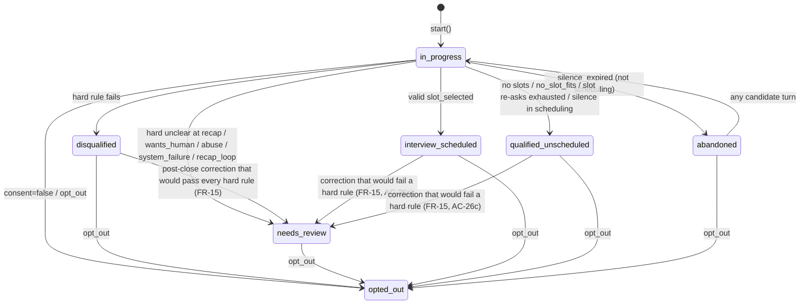
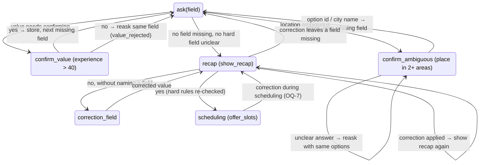

# Plan 002 — Screening engine (deterministic core)

**Implements:** [spec.md](spec.md) · **Contract:** [ADR 0005](../../adr/0005-engine-turn-contract.md) · **Rules:** [ADR 0002](../../adr/0002-hybrid-state-machine.md), [ADR 0004](../../adr/0004-qualification-rules-and-scoring.md) · **Source of truth:** [process-design.md](../001-process-design/process-design.md)

**Status:** Approved and implemented (2026-10-11). Deviations are recorded under each task in [tasks.md](tasks.md); notably `step.py` became `turn.py` (a submodule named `step` shadowed the exported `step()` function) and proposal application lives in `apply.py`.

## 1. Approach

The engine is a small pure-Python package: Pydantic models at the boundary, plain functions for validation and rules, and a single `step()` function that applies the FR-10 precedence. A full graph state machine is not needed. Because input can arrive out of order (FR-8), the next question is always the result of one data-driven query: *"which is the first field in stage order that is still missing?"* (`next_missing_field`). The only real "states" are the kinds of answer we wait for (a field, a value confirmation, an ambiguity choice, the recap, a slot). So `step()` dispatches on `state.pending.kind` (6 small handlers). It does not dispatch on 11 stages that would all do the same thing. Config is loaded and validated once, outside the engine (it is the only I/O). The engine receives it as an argument, with `today`, which keeps it pure (FR-1, NFR-1/2).

Design goals, in order: **readable live** (an Orbio engineer should follow one turn from top to bottom in `step.py`), **total** (no input raises, NFR-5), **auditable** (every outcome traces to a config rule and a stored value, NFR-6).

## 2. Components & files

```
config/                                   # repo root, client-editable (FR-29)
  service_areas.yaml
  screening.yaml
backend/src/sazon_screening/        # imports flow one way: engine -> config -> vocab
  vocab.py             # shared enums: FieldName, Stage, Status, VehicleType, Availability, ScheduleSlot,
                       # Weekday, Language, Register, Country, ReaskReason, DisqualificationReason,
                       # ReviewReason, Flag, FieldStatus, PendingKind, Bucket
  config/
    __init__.py        # re-exports EngineConfig, load_config, ConfigError
    areas.py           # normalise(), AreaRef, IndexEntry, LocationIndex (built from service_areas.yaml)
    models.py          # ServiceAreasConfig, ScreeningConfig, Thresholds, ScoringConfig, EngineConfig (+ validators)
    loader.py          # load_config(config_dir) -> EngineConfig; ConfigError  (the only I/O)
  engine/
    __init__.py        # public API: plain explicit imports + __all__ (start, step, build_record, ...)
    flow.py            # FIELD_ORDER, FIELD_STAGE, HARD_FIELDS, SOFT_FIELDS, next_missing_field()
    inputs.py          # proposals (discriminated union), StartDateExpr, Signals, TurnContext,
                       # CandidateTurn, events, TurnInput
    state.py           # Slot[T], Profile, PendingAsk, ConversationState, PostCloseCorrection
    actions.py         # primary actions + prefaces (discriminated unions), EngineAction, register_for()
    validators.py      # validate_consent/name/age/vehicle/license/availability/schedule/
                       # experience/start_date, resolve_start_date(); FieldOutcome types
    location.py        # match_location(), validate_location() (reads config.areas.LocationIndex)
    rules.py           # license_need(), min_age_for(), hard_rule_failure(), review_reasons()
    turn.py            # start(), step(), step_unchecked(): precedence, events, closed statuses
    apply.py           # apply_proposals(), validate_proposal(), confirmation answers
    collect.py         # re-ask policy, next_action(), pending-kind handlers
    closing.py         # close_* helpers, opt-out purge, recap + scheduling transitions
    scoring.py         # score_candidate() -> ScoreResult
    record.py          # CandidateRecord, build_record()
backend/tests/
  fixtures/config/{service_areas,screening}.yaml   # small, stable config used by AC tests
  config/              # test_models.py, test_loader.py, test_shipped_config.py
  engine/              # conftest.py, builders.py (fluent Convo driver), test_*.py (see §7)
backend/scripts/export_record_schema.py            # writes candidate-record.schema.json (contract for 004/006)
```

Size target: no module over ~250 lines. `turn.py` + `apply.py` + `collect.py` + `closing.py` together are the "state machine", split so each fits on a screen.

Dependencies:
- **`tzdata`** (runtime). It lets us validate `timezone` values with `zoneinfo.ZoneInfo`. On Windows and slim containers there is no system tz database, so without it every timezone fails to validate. This is the package the Python docs recommend for that case. It is pure data.
- **`hypothesis`** (dev only). Used for the property test (§7.4).
- No other new dependencies. In particular: no state machine library and no rapidfuzz (§5).

## 3. Data models / interfaces

All boundary models use `ConfigDict(extra="forbid")`. Inputs, actions and config are `frozen=True`. `ConversationState` is mutable but never mutated in place by callers (see §4.1). Sets are stored as **sorted, de-duplicated lists**: set iteration order for strings changes with `PYTHONHASHSEED`, which would break NFR-1 determinism in JSON output.

### 3.1 Enums (`engine/enums.py`, all `StrEnum`)

| Enum | Values |
|---|---|
| `FieldName` | `consent, full_name, age, vehicle_type, has_license, location, zone, availability, schedule, experience, start_date, slot` (`zone` and `slot` are ask/re-ask targets only, not stored as separate fields) |
| `Stage` | `consent, name, age, vehicle_license, location, availability, schedule, experience, start_date, recap, scheduling` |
| `Status` | `in_progress, interview_scheduled, qualified_unscheduled, disqualified, needs_review, abandoned, opted_out` |
| `VehicleType` | `motorbike, car, bicycle, e_bike, none` |
| `Availability` | `full_time, part_time, weekends` |
| `ScheduleSlot` | `morning, afternoon, evening, flexible` |
| `Weekday` | `mon … sun` |
| `Language` / `Register` / `Country` | `es, en` / `es-ES, es-MX, en` / `ES, MX` |
| `FieldStatus` | `valid, unclear, not_asked, not_required` |
| `PendingKind` | `ask, confirm_value, confirm_ambiguous, recap, correction_field, slot` |
| `ReaskReason` | `unclear, not_recognised, surname_missing, invalid_characters, implausible_value, negative_value, missing_years, empty_selection, consent_required, slot_not_offered, extraction_failed, value_rejected` |
| `DisqualificationReason` | `under_age, no_license, out_of_area` |
| `ReviewReason` | `age_unclear, license_unclear, vehicle_unclear, location_unclear, human_requested, system_failure, abuse, recap_loop, post_close_correction, engine_error` |
| `Flag` | `surname_missing, name_unclear, start_date_normalised, human_requested, post_close_correction, system_failure, abuse, do_not_contact, engine_error` |
| `Bucket` | `high, medium, low` |

### 3.2 Flow tables (`engine/flow.py`)

```
FIELD_ORDER = [consent, full_name, age, vehicle_type, has_license, location, zone,
               availability, schedule, experience, start_date]
FIELD_STAGE = {consent: consent, full_name: name, age: age, vehicle_type: vehicle_license,
               has_license: vehicle_license, location: location, zone: location, availability: ...,
               slot: scheduling}
HARD_FIELDS = {age, has_license, location, zone}        # vehicle_type is hard only when license_need is "depends"
SOFT_FIELDS = {availability, schedule, experience, start_date}
# full_name and consent are neither (FR-16: required, not qualifying; consent: see OQ-1)

def next_missing_field(state: ConversationState, config: EngineConfig) -> FieldName | None
```
`next_missing_field` walks `FIELD_ORDER` and returns the first slot with status `not_asked`, with three special cases:
- `has_license` is skipped when `license_need(vehicle) == "not_required"`.
- `zone` is returned when the location has a city with configured zones but `zone is None` (and location is not `unclear`).
- `consent` is missing until it is `True`.

Fields with status `unclear` count as done (FR-24).

### 3.3 Inputs (`engine/inputs.py`), what 003 / 008 / 010 send

```python
class Unclear(BaseModel):            # the UNCLEAR marker
    kind: Literal["unclear"] = "unclear"
UNCLEAR = Unclear()

# Start-date expression (FR-22), discriminated on "kind"
class Asap(BaseModel):         kind: Literal["asap"]
class AbsoluteDate(BaseModel): kind: Literal["absolute"]; on: date
class Offset(BaseModel):       kind: Literal["offset"]; amount: int; unit: Literal["days", "weeks"]
class NextWeekday(BaseModel):  kind: Literal["next_weekday"]; weekday: Weekday
StartDateExpr = Annotated[Asap | AbsoluteDate | Offset | NextWeekday, Field(discriminator="kind")]

class AgeAnswer(BaseModel):    is_adult: bool | None = None; age: int | None = None   # validator: at least one set
class LocationAnswer(BaseModel): text: str; is_known_place: bool                      # FR-19
class ExperienceAnswer(BaseModel): years: int | Literal["none"] | None; platforms: list[str] = []

# One proposal model per field, discriminated on "field". Every one has a `value` that may be UNCLEAR.
class ConsentProposal(BaseModel):     field: Literal["consent"];      value: bool | Unclear
class NameProposal(BaseModel):        field: Literal["full_name"];    value: str | Unclear
class AgeProposal(BaseModel):         field: Literal["age"];          value: AgeAnswer | Unclear
class VehicleProposal(BaseModel):     field: Literal["vehicle_type"]; value: VehicleType | Unclear
class LicenseProposal(BaseModel):     field: Literal["has_license"];  value: bool | Unclear
class LocationProposal(BaseModel):    field: Literal["location"];     value: LocationAnswer | Unclear
class AvailabilityProposal(BaseModel):field: Literal["availability"]; value: list[Availability] | Unclear
class ScheduleProposal(BaseModel):    field: Literal["schedule"];     value: list[ScheduleSlot] | Unclear
class ExperienceProposal(BaseModel):  field: Literal["experience"];   value: ExperienceAnswer | Unclear
class StartDateProposal(BaseModel):   field: Literal["start_date"];   value: StartDateExpr | Unclear
class ConfirmationProposal(BaseModel):field: Literal["confirmation"]; value: bool | Unclear  # recap yes/no, confirm_value
class ChoiceProposal(BaseModel):      field: Literal["choice"];       value: str | Unclear   # option id for confirm_ambiguous
Proposal = Annotated[ConsentProposal | ... | ChoiceProposal, Field(discriminator="field")]

class Signals(BaseModel):
    opt_out: bool = False; wants_human: bool = False; correction: bool = False
    faq_question: bool = False; off_topic: bool = False; abuse: bool = False
    extraction_failed: bool = False; language: Language | None = None

class TurnContext(BaseModel):
    country_hint: Country | None = None
    offered_slots: list[str] | None = None   # slot ids from 010; read only when entering scheduling

class CandidateTurn(BaseModel):  kind: Literal["turn"] = "turn"; proposals: list[Proposal] = []
                                 signals: Signals = Signals(); context: TurnContext = TurnContext()
class SilenceExpired(BaseModel): kind: Literal["silence_expired"] = "silence_expired"
class SlotSelected(BaseModel):   kind: Literal["slot_selected"] = "slot_selected"; slot_id: str
class NoSlotFits(BaseModel):     kind: Literal["no_slot_fits"] = "no_slot_fits"
TurnInput = Annotated[CandidateTurn | SilenceExpired | SlotSelected | NoSlotFits, Field(discriminator="kind")]
```
Notes:
- Zone answers arrive as a `LocationProposal`. When the pending field is `zone`, the text is matched inside the known city first (§3.6). That way the extractor (003) has only one location schema.
- Pydantic types are deliberately permissive: `age` is any int and `years` any int. Range checks are business rules and produce re-asks (NFR-5). Malformed JSON from the LLM fails in 003 when it builds `CandidateTurn`, and 003 maps that to `extraction_failed`. The engine never sees invalid models.
- `TurnInput` and `Proposal` give 003 a JSON schema for structured output for free (`TypeAdapter(Proposal).json_schema()`).

### 3.4 State (`engine/state.py`)

```python
class Slot[T](BaseModel):                     # PEP 695 generic; fallback BaseModel + Generic[T]
    status: FieldStatus = FieldStatus.not_asked
    value: T | None = None

class LocationValue(BaseModel):
    raw_text: str                              # what the candidate said (audit, NFR-6)
    country: Country | None; city: str | None; zone: str | None   # config IDs
    in_service_area: bool                      # False only for a real place we do not serve

class Experience(BaseModel): years: int; platforms: list[str]   # platform ids or "other:<text>"

class Profile(BaseModel):
    full_name: Slot[str]; age: Slot[AgeAnswer]; vehicle_type: Slot[VehicleType]
    has_license: Slot[bool]; location: Slot[LocationValue]
    availability: Slot[list[Availability]]; schedule: Slot[list[ScheduleSlot]]
    experience: Slot[Experience]; start_date: Slot[date]

class AreaRef(BaseModel): id: str; country: Country; city: str; zone: str | None   # id = zone or city id

class PendingAsk(BaseModel):
    kind: PendingKind
    field: FieldName | None                    # None for recap / correction_field
    candidate_value: Experience | None = None  # confirm_value payload (experience > 40)
    options: list[AreaRef] = []                # confirm_ambiguous payload

class PostCloseCorrection(BaseModel):
    field: FieldName; original: JsonValue; proposed: JsonValue

class ConversationState(BaseModel):
    model_config = ConfigDict(validate_assignment=True)
    state_version: Literal[1] = 1
    status: Status = Status.in_progress
    stage: Stage = Stage.consent
    pending: PendingAsk                        # always set while in_progress / abandoned
    consent: bool | None = None
    profile: Profile = Profile()
    reasks: dict[FieldName, int] = {}          # FR-23 counters (audit: never reset)
    consecutive_extraction_failures: int = 0
    abuse_count: int = 0
    recap_rounds: int = 0                      # number of show_recap emitted
    flags: list[Flag] = []                     # sorted, unique (helper add_flag)
    needs_review_reasons: list[ReviewReason] = []
    disqualification_reason: DisqualificationReason | None = None
    drop_off_stage: Stage | None = None
    language: Language = Language.es
    country_hint: Country | None = None
    offered_slot_ids: list[str] = []
    selected_slot_id: str | None = None
    post_close_corrections: list[PostCloseCorrection] = []
    config_version: str = ""
    last_turn_on: date | None = None           # injected `today` of the last step (used by scoring)
```
While the zone is still missing, `location` has `status = not_asked` and a partial value (city known, `zone = None`). It becomes `valid` once resolved, or `unclear` if the zone re-asks run out.

### 3.5 Actions (`engine/actions.py`)

```python
# Primary actions, discriminated on "type"
AskField(field)                                   ReaskField(field, reason: ReaskReason, options: list[str])
ConfirmAmbiguous(field, options: list[AreaRef])   ConfirmValue(field, value: Experience)
AskCorrectionField()                              ShowRecap(profile: Profile)
OfferSlots(slot_ids: list[str])                   ConfirmInterview(slot_id)
CloseDisqualified(reason: DisqualificationReason) CloseNeedsReview(reasons: list[ReviewReason])
CloseOptedOut()  CloseQualifiedUnscheduled()  HandoffToHuman()  ClosedAck()
PrimaryAction = Annotated[AskField | ... | ClosedAck, Field(discriminator="type")]

# Prefaces
AnswerFaq()   AckCorrection(fields: list[FieldName])   Redirect(reason: Literal["off_topic", "abuse"])
Preface = Annotated[AnswerFaq | AckCorrection | Redirect, Field(discriminator="type")]

class EngineAction(BaseModel):
    primary: PrimaryAction
    prefaces: list[Preface] = []     # fixed order: redirect, ack_correction, answer_faq
    language: Language
    register: Register

def register_for(language: Language, country: Country | None, country_hint: Country | None,
                 default_country: Country) -> Register
# en -> "en"; es -> country of the stored location, else country_hint, else config default_country
```
Options are **IDs** (enum values, city IDs, zone IDs, slot IDs). The phrasing layer (003) turns them into display names using `config` names per language. The engine stays language-neutral.

### 3.6 Validators (`engine/validators.py`, `engine/location.py`)

Internal outcome types are frozen `dataclass`es (not Pydantic: they never cross a boundary):
```python
@dataclass(frozen=True) class Accepted[T]:  value: T; flags: tuple[Flag, ...] = ()
@dataclass(frozen=True) class Rejected:     reason: ReaskReason; options: tuple[str, ...] = ()
@dataclass(frozen=True) class NeedsConfirmation:  # confirm_value or confirm_ambiguous
    kind: Literal["value", "ambiguous"]; value: Experience | None = None; options: tuple[AreaRef, ...] = ()
```

| Function | Rules (FR) |
|---|---|
| `validate_consent(v: bool \| Unclear) -> Accepted[bool] \| Rejected` | Only an explicit `True`/`False` is accepted; `Unclear` → `consent_required` (FR-7). |
| `validate_name(v, *, reasks_used: int) -> Accepted[str] \| Rejected` | Trim/collapse spaces. Each char must be a letter (`str.isalpha`, so accents count), a space, `-`, `'` or `’`, else `invalid_characters`. One word: `surname_missing` if `reasks_used == 0`, else Accepted + flag `surname_missing` (FR-16, AC-15). |
| `validate_age(v, *, min_plausible, max_plausible) -> Accepted[AgeAnswer] \| Rejected` | Age outside `[min_plausible, max_plausible]` → `implausible_value`. Under-age is **not** decided here (rules.py). When both are given, the explicit `age` wins over `is_adult` (FR-17). |
| `validate_vehicle`, `validate_license` | Enum / bool, else `unclear` with options = enum values (FR-18). |
| `validate_availability`, `validate_schedule` | Non-empty → sorted unique list; empty or Unclear → `empty_selection`/`unclear` with all options (FR-20). |
| `validate_experience(v, *, platforms, confirm_above) -> Accepted[Experience] \| Rejected \| NeedsConfirmation` | `"none"` → `Experience(0, [])`. Negative → `negative_value`. `None` → `missing_years`. `> confirm_above` → `NeedsConfirmation("value")`. Platforms are matched exactly (after `normalise`) against platform ids and aliases, otherwise `other:<original text>` (FR-21, AC-16). |
| `resolve_start_date(expr, today) -> tuple[date, bool]` | `asap` → today. `absolute` → itself, or today + `normalised=True` if in the past. `offset(n, days\|weeks)` → today + n. `next_weekday(wd)` → the **next** occurrence strictly after today (Monday + `mon` → +7). |
| `validate_start_date(v, today) -> Accepted[date] \| Rejected` | Negative offset → `negative_value`; normalised → flag `start_date_normalised` (FR-22, AC-17). |

**Location matching (`location.py`, FR-19).**
```python
def normalise(text: str) -> str      # NFKD, drop combining marks, casefold, punctuation -> space, collapse spaces
class LocationIndex:                  # built once per EngineConfig (PrivateAttr, built in a model validator)
    entries: list[IndexEntry]         # IndexEntry(key: normalised name/alias, ref: AreaRef, level: "city" | "zone")
def match_location(text: str, index: LocationIndex, *, threshold: int,
                   country_hint: Country | None, within_city: str | None) -> LocationMatch
LocationMatch = Matched(refs: tuple[AreaRef, ...]) | CityWithUnknownZone(city: AreaRef, residual: str) | NoMatch
def validate_location(answer: LocationAnswer | Unclear, config: EngineConfig, *,
                      country_hint: Country | None, current: LocationValue | None,
                      pending_zone: bool) -> Accepted[LocationValue] | Rejected | NeedsConfirmation
```
Algorithm:
1. Split the text into segments: the whole text, plus parts split on `,` `/` `(` `)`.
2. For each segment, find **exact** hits on normalised names and aliases. If there are none, and the segment has at least 4 characters, take **fuzzy** hits: `difflib.SequenceMatcher(None, a, b).ratio() * 100 >= threshold`, keeping every hit within 2 points of the best score.
3. Combine the segments. If a city hit and zone hits exist in the same city, keep the zones of that city ("Coyoacán, CDMX"). If the city is the only hit, the result is the city. If the city hit plus an unmatched segment, the result is `CityWithUnknownZone` ("Vallecas, Madrid").
4. When `within_city` is set (pending zone), match against that city's zones first and fall back to a global match (the candidate may be relocating).
5. If more than one distinct ref remains, filter by `country_hint` **only if** that leaves at least one.

`validate_location` maps the match to FR-19 outcomes:

| Match | `is_known_place` | Outcome |
|---|---|---|
| 1 ref (zone, or city without zones) | any | Accepted, `in_service_area = True` |
| 1 city with zones, no zone | any | Accepted partial (status stays `not_asked`) → next ask is `zone` (AC-14) |
| > 1 refs | any | `NeedsConfirmation("ambiguous", options)` (AC-13) |
| `CityWithUnknownZone` / `NoMatch` | true | Accepted, `in_service_area = False` → hard rule `out_of_area` (AC-10, AC-11) |
| `CityWithUnknownZone` | false | `Rejected(not_recognised, options = that city's zone ids)` |
| `NoMatch` | false / Unclear | `Rejected(not_recognised, options = served city ids)` (AC-11) |

### 3.7 Rules (`engine/rules.py`)

```python
LicenseNeed = Literal["required", "not_required", "depends"]
def license_need(vehicle: VehicleType | None, config: EngineConfig) -> LicenseNeed
    # None/unclear vehicle: "required" if all vehicle types require it, "not_required" if none do, else "depends"
def min_age_for(country: Country | None, config: EngineConfig) -> int
    # unknown country -> the LOWEST configured minimum (never disqualify on ambiguity; re-evaluated later)
def hard_rule_failure(state: ConversationState, config: EngineConfig) -> DisqualificationReason | None
    # checked in stage order: under_age (valid age < min, or is_adult False) ->
    # no_license (has_license valid False and license_need(vehicle) == "required") ->
    # out_of_area (location valid and not in_service_area)
def review_reasons(profile: Profile, config: EngineConfig) -> list[ReviewReason]
    # age unclear -> age_unclear; location unclear -> location_unclear;
    # has_license unclear and need != not_required -> license_unclear;
    # vehicle unclear and need(None) == "depends" and has_license is not True -> vehicle_unclear
def sync_license_requirement(state: ConversationState, config: EngineConfig) -> None
    # need == not_required -> has_license.status = not_required (value kept for audit);
    # otherwise a not_required slot goes back to valid (value present) or not_asked (AC-8, AC-9)
DISQUALIFYING_FIELDS = {under_age: {age}, no_license: {has_license, vehicle_type}, out_of_area: {location}}
```

### 3.8 Scoring (`engine/scoring.py`, FR-30)

```python
class ScoreFactor(BaseModel): field: FieldName; value: str | int | list[str] | None; points: int; reason_code: FactorReason
# FactorReason: years_of_experience, known_platforms, availability_breadth, schedule_flexibility,
#               start_date_proximity, unknown
class ScoreResult(BaseModel): score: int; bucket: Bucket; factors: list[ScoreFactor]; max_score: int
def score_candidate(profile: Profile, config: EngineConfig, *, reference_date: date) -> ScoreResult
```
There are exactly 5 factors, in a fixed order: `experience` years, `experience` platforms, `availability`, `schedule`, `start_date`. A field that is `unclear` or `not_asked` gives `points = 0` with reason `unknown`. `score = sum(points)`, enforced by a test. Start-date proximity is `max(0, (start_date - reference_date).days)` matched against the configured bands. `reference_date` is `state.last_turn_on`, which keeps the score pure and reproducible.

### 3.9 Record (`engine/record.py`, FR-31)

```python
class FieldRecord[T](BaseModel): status: FieldStatus; value: T | None
class RecordFields(BaseModel):   full_name, age, vehicle_type, has_license, location,
                                 availability, schedule, experience, start_date  (FieldRecord each)
class CandidateRecord(BaseModel):
    record_version: Literal[1] = 1
    status: Status; disqualification_reason: DisqualificationReason | None
    needs_review_reasons: list[ReviewReason]; score: ScoreResult | None; flags: list[Flag]
    language: Language; drop_off_stage: Stage | None; selected_slot_id: str | None
    config_version: str; consent: bool | None; fields: RecordFields
    post_close_corrections: list[PostCloseCorrection]
def build_record(state: ConversationState, config: EngineConfig) -> CandidateRecord
    # score only for interview_scheduled / qualified_unscheduled / needs_review, else None
```
`backend/scripts/export_record_schema.py` writes `docs/specs/002-screening-engine/candidate-record.schema.json`. A test fails if the committed schema is out of date, which turns the record into an explicit contract for 004/006.

### 3.10 Config models (`config/models.py`, FR-29, AC-35)

```python
class Area(BaseModel):  id: str (slug regex ^[a-z0-9-]+$); names: dict[Language, str]; aliases: list[str] = []
class Zone(Area): pass
class City(Area):       timezone: str; zones: list[Zone] = []      # no zones = whole city served
class CountryArea(Area): id: Country; cities: list[City]
class ServiceAreasConfig(BaseModel): version: str; countries: list[CountryArea]
    # validators: all ids unique across the whole file (named in error); timezone loads via ZoneInfo;
    # inside one city no two zones share a normalised name/alias (cross-city sharing is allowed and intended)
class Platform(BaseModel): id: str; aliases: list[str] = []
class Thresholds(BaseModel):
    max_reasks: int = 2; max_recap_rounds: int = 3; max_consecutive_extraction_failures: int = 3
    abuse_close_count: int = 2; fuzzy_match_min_score: int = Field(85, ge=50, le=100)
    min_plausible_age: int = 14; max_plausible_age: int = 99; experience_confirm_above_years: int = 40
class StartDateBand(BaseModel): within_days: int; points: int
class ScoringConfig(BaseModel):
    experience_years: PerUnit (points_per_year, max_points); platforms: PerUnit (points_per_known_platform, max_points)
    availability: dict[Availability, int] + max_points; schedule: flexible, per_slot, max_points
    start_date: list[StartDateBand]; buckets: Buckets(high, medium)
    # validators: all Availability keys present; bands strictly increasing within_days;
    # 0 < medium < high <= max_score
class ScreeningConfig(BaseModel):
    version: str; default_country: Country; min_age: dict[Country, int]
    license_required: dict[str, bool]   # validated: every VehicleType present, unknown key -> error naming it
    platforms: list[Platform]; thresholds: Thresholds; scoring: ScoringConfig
class EngineConfig(BaseModel):          # frozen
    service_areas: ServiceAreasConfig; screening: ScreeningConfig
    # cross-file: min_age has a value for every configured country
    @property version -> f"{screening.version}+{service_areas.version}"
    location_index: LocationIndex (PrivateAttr, built after validation)
```
`license_required` is typed `dict[str, bool]` and checked by a custom validator. That gives the error the spec asks for (`unknown vehicle type 'scooter' in license_required; allowed: motorbike, car, …`), which reads better than Pydantic's default enum message.

`config/loader.py`:
```python
class ConfigError(Exception): ...                 # message lists "<file>: <dotted.path>: <problem>" per error
def load_config(config_dir: Path) -> EngineConfig  # reads service_areas.yaml + screening.yaml (yaml.safe_load)
```
004 decides where `config_dir` comes from (env var or repo-root `config/`). The engine never loads files.

### 3.11 Config file design (excerpts; full files are task T6)

`config/service_areas.yaml`. Real cities and zones. Two deliberate ambiguities:
- **"El Carmen"**: a barrio in Valencia (ES) and a municipality in the Monterrey metro area (MX). `country_hint` resolves it (AC-13).
- **"Centro"**: a zone in Madrid, Málaga, Guadalajara and Monterrey, and an alias in Sevilla and Puebla. It is still ambiguous inside one country, so the engine always confirms.

```yaml
version: "2026-10-11.1"
countries:
  - id: ES
    names: {es: España, en: Spain}
    cities:
      - id: madrid
        names: {es: Madrid, en: Madrid}
        aliases: [MAD]
        timezone: Europe/Madrid
        zones:
          - {id: mad-centro,    names: {es: Centro, en: Centro}, aliases: [Sol, Malasaña, Lavapiés]}
          - {id: mad-chamberi,  names: {es: Chamberí, en: Chamberí}}
          - {id: mad-salamanca, names: {es: Salamanca, en: Salamanca}}
          - {id: mad-retiro,    names: {es: Retiro, en: Retiro}}
          - {id: mad-tetuan,    names: {es: Tetuán, en: Tetuán}}
          # Vallecas deliberately NOT served (AC-10 demo)
      - id: barcelona
        aliases: [BCN, Barna]
        timezone: Europe/Madrid
        zones: [Ciutat Vella, Eixample, Gràcia (alias Gracia), Sants-Montjuïc (alias Sants), Sant Martí (alias Poblenou)]
      - id: valencia
        zones: [El Carmen (alias El Carme), Ruzafa (alias Russafa), Benimaclet, El Cabanyal (alias Cabanyal), Campanar]
      - id: sevilla
        aliases: [Seville]
        zones: [Triana, Nervión, Macarena, Los Remedios, Casco Antiguo (alias Centro)]
      - id: malaga
        zones: [Centro, El Palo, Teatinos, Huelin, Cruz de Humilladero]
  - id: MX
    cities:
      - id: cdmx
        names: {es: Ciudad de México, en: Mexico City}
        aliases: [CDMX, DF, D.F., Distrito Federal, Ciudad de Mexico]
        timezone: America/Mexico_City
        zones:
          - {id: cdmx-coyoacan,   names: {es: Coyoacán, en: Coyoacán}}
          - {id: cdmx-cuauhtemoc, names: {es: Cuauhtémoc, en: Cuauhtémoc}, aliases: [Roma, Condesa, Centro Histórico]}
          - {id: cdmx-benito-juarez, names: {es: Benito Juárez, en: Benito Juárez}, aliases: [Del Valle, Narvarte]}
          - {id: cdmx-miguel-hidalgo, names: {...}, aliases: [Polanco]}
          - {id: cdmx-alvaro-obregon, names: {...}, aliases: [San Ángel]}
          # Iztapalapa deliberately NOT served
      - id: guadalajara  (aliases: [GDL, Guanatos]; zones: Centro, Providencia, Chapultepec, Zapopan, Tlaquepaque)
      - id: monterrey    (aliases: [MTY, Mty]; timezone America/Monterrey;
                          zones: Centro, San Pedro Garza García (alias San Pedro, SPGG), Cumbres, Obispado, El Carmen)
      - id: puebla       (aliases: [Pue]; zones: Centro Histórico (alias Centro), Angelópolis, La Paz, Cholula)
```
(The compact `(…)` lines show content only. The real file uses the full mapping form shown for Madrid.)

`config/screening.yaml`:
```yaml
version: "2026-10-11.1"
default_country: ES
min_age: {ES: 18, MX: 18}                 # assumption, to confirm with client (spec §7 #3)
license_required:                         # brief: license required; per-vehicle override (spec §7 #2)
  motorbike: true
  car: true
  bicycle: true
  e_bike: true
  none: true
platforms:
  - {id: glovo,       aliases: [glovo]}
  - {id: uber_eats,   aliases: [uber eats, ubereats, uber]}
  - {id: just_eat,    aliases: [just eat, justeat]}
  - {id: deliveroo,   aliases: [deliveroo]}
  - {id: rappi,       aliases: [rappi]}
  - {id: didi_food,   aliases: [didi, didi food]}
  - {id: amazon_flex, aliases: [amazon flex, amazon]}
thresholds:                               # spec §7 #11
  max_reasks: 2
  max_recap_rounds: 3
  max_consecutive_extraction_failures: 3
  abuse_close_count: 2
  fuzzy_match_min_score: 85
  min_plausible_age: 14
  max_plausible_age: 99
  experience_confirm_above_years: 40
scoring:                                  # max 100
  experience_years: {points_per_year: 5, max_points: 20}
  platforms:        {points_per_known_platform: 10, max_points: 20}   # "other:*" scores 0
  availability:     {full_time: 15, part_time: 8, weekends: 7, max_points: 25}
  schedule:         {flexible: 15, per_slot: 5, max_points: 15}
  start_date:
    - {within_days: 3,  points: 20}
    - {within_days: 14, points: 10}
    - {within_days: 30, points: 5}
  buckets: {high: 60, medium: 35}         # score >= 60 high, >= 35 medium, else low
```
Worked example (AC-33 candidate: 3 years, glovo, {full_time, weekends}, flexible, asap): 15 + 10 + 22 + 15 + 20 = **82 → high**.

## 4. Flow

### 4.1 `step()` (pseudo-code, `step.py`)

```python
def start(config, *, language=Language.es, country_hint=None) -> tuple[ConversationState, EngineAction]
    # state with pending = ask(consent); action = ask_field(consent)

def step(state, turn, config, today) -> tuple[ConversationState, EngineAction]:
    try:
        return step_unchecked(state, turn, config, today)
    except Exception:                       # NFR-5 last-resort guard; tests call step_unchecked directly
        if state.status is OPTED_OUT: return state, finish(state, ClosedAck())
        s = state.model_copy(deep=True)
        close_needs_review(s, ReviewReason.engine_error, flag=Flag.engine_error)
        return s, finish(s, CloseNeedsReview(...))

def step_unchecked(state, turn, config, today):
    s = state.model_copy(deep=True)         # copy on entry; handlers mutate s; caller's state is untouched
    s.config_version = config.version; s.last_turn_on = today
    out = Prefaces()
    match turn:
        case SilenceExpired(): primary = on_silence(s)
        case SlotSelected() | NoSlotFits(): primary = on_slot_event(s, turn, config)
        case CandidateTurn():  primary = on_candidate_turn(s, turn, config, today, out)
    return s, finish(s, primary, out, config)   # attaches language + register_for(...)

def on_candidate_turn(s, t, cfg, today, out):
    sig = t.signals
    language_changed = sig.language is not None and sig.language != s.language
    if sig.language: s.language = sig.language
    if t.context.country_hint: s.country_hint = t.context.country_hint
    # FR-10 (1) opt-out: every stage and status (FR-11)
    if s.status is OPTED_OUT: return ClosedAck()                  # terminal (OQ-4)
    if sig.opt_out: return opt_out(s)                              # purge + do_not_contact
    # closed statuses (FR-15)
    if s.status in CLOSED: return on_closed(s, t, cfg, today, out)
    resumed = s.status is ABANDONED
    if resumed: s.status = IN_PROGRESS                              # FR-14 resume
    # FR-10 (2) abuse (FR-28)
    if sig.abuse:
        s.abuse_count += 1
        if s.abuse_count >= cfg.thresholds.abuse_close_count:
            return close_needs_review(s, ReviewReason.abuse, flag=Flag.abuse)
        out.add(Redirect("abuse"))
    # FR-27 extraction failure: repeat pending, no re-ask consumed
    if sig.extraction_failed and not t.proposals:
        s.consecutive_extraction_failures += 1
        if s.consecutive_extraction_failures >= cfg.thresholds.max_consecutive_extraction_failures:
            return close_needs_review(s, ReviewReason.system_failure, flag=Flag.system_failure)
        return repeat_pending(s, reason=ReaskReason.extraction_failed)
    s.consecutive_extraction_failures = 0
    # FR-10 (3) apply proposals (stage order, latest wins) + hard rules
    applied = apply_proposals(s, t, cfg, today)     # consent gate inside (FR-7); opt-out if consent False
    if applied.declined_consent: return opt_out(s)
    if sig.correction and applied.changed: out.add(AckCorrection(applied.changed))
    sync_license_requirement(s, cfg)
    if reason := hard_rule_failure(s, cfg): return close_disqualified(s, reason)
    # FR-10 (4) wants_human, (5) faq / off-topic
    if sig.wants_human: return handoff(s)          # needs_review + human_requested
    if sig.faq_question: out.add(AnswerFaq())
    if sig.off_topic: out.add(Redirect("off_topic"))
    # FR-10 (6) next ask: dispatch on what we were waiting for
    attempt = classify_attempt(s, t, applied, neutral=resumed or language_changed
                               or sig.faq_question or sig.off_topic or sig.abuse)
    return HANDLERS[s.pending.kind](s, t, applied, attempt, cfg)
```

`apply_proposals` (`collect.py`):
1. Keep the last proposal per field, then sort by `FIELD_ORDER`. `confirmation` and `choice` are kept apart for the handlers.
2. **Consent gate (FR-7).** If consent is not `True`: validate any consent proposal. `True` → set it and continue. `False` → return `declined_consent`. Anything else → **discard all other proposals**.
3. For each proposal, call its validator. `Accepted` → store it (latest wins, FR-9), add flags, and record it in `changed` if the old value was set and different. `Rejected` → only kept as `pending_outcome` if the field is the pending one (`zone` pending ↔ `location` proposal). Otherwise ignore it: nothing stored, nothing counted. `NeedsConfirmation` → if the field is pending, or no other confirmation was raised this turn, it becomes the new pending (`confirm_value` / `confirm_ambiguous`). Later ones are dropped and simply asked again in order.
4. Return `Applied(accepted: set[FieldName], changed: list[FieldName], pending_outcome, confirmation, choice, declined_consent)`.

`classify_attempt` (FR-23, AC-20) returns one of:
- `answered`: the pending field was accepted or now needs confirmation.
- `failed(reason, options)`: the pending field was `Rejected`, **or** the turn has no proposals at all and is not neutral. Neutral turns are FAQ, off-topic, first abuse, a language change, or the first turn after a resume (AC-29 expects `ask_field`, not `reask_field`).
- `neutral`: anything else, e.g. only other fields were filled, or a FAQ-only turn.

Handlers (`collect.py` / `closing.py`):

| `pending.kind` | Behaviour |
|---|---|
| `ask` | `failed` → `reask_or_exhaust(field)`; otherwise `next_action()`. |
| `confirm_value` | `confirmation=True` → store `candidate_value`; `False` → `failed(value_rejected)` (re-asks the field). A new experience proposal is validated again. Unclear → `failed`. |
| `confirm_ambiguous` | `choice` id in options → store that `AreaRef` (`in_service_area=True`). A new location proposal whose city/country matches **one** option → that option. Else `failed` → re-ask with the same options. |
| `recap` | `changed` → `show_recap()` (AC-23). `confirmation=True` → `enter_scheduling()` (AC-22). `confirmation=False` with no change → `AskCorrectionField` (AC-25). Otherwise → `show_recap()`. |
| `correction_field` | `changed` → `show_recap()`. `confirmation=True` → `enter_scheduling()`. Otherwise → `show_recap()`. |
| `slot` (candidate turn) | `changed` → `show_recap()` (re-confirm, then re-offer). Otherwise `failed` → `reask_or_exhaust(slot)`. |

```python
def reask_or_exhaust(s, field, reason, options, cfg) -> PrimaryAction | None:   # FR-23 / FR-24
    s.reasks[field] += 1                                        # attempts = 1 + reasks
    if s.reasks[field] <= cfg.thresholds.max_reasks:
        return ReaskField(field, reason, options or default_options(field, s, cfg))
    exhaust(s, field)            # soft/hard -> slot status unclear; full_name -> + flag name_unclear;
                                 # zone -> location unclear (keeps partial city);
                                 # slot -> close_qualified_unscheduled; consent -> see OQ-1
    return None                  # caller continues with next_action()

def next_action(s, cfg) -> PrimaryAction:
    if (field := next_missing_field(s, cfg)) is not None:
        set_pending(s, ask, field)                               # also updates s.stage = FIELD_STAGE[field]
        return AskField(field)
    if reasons := review_reasons(s.profile, cfg):                # FR-24: hard unclear -> needs_review at recap
        s.stage = RECAP
        return close_needs_review(s, *reasons)                    # AC-19
    return show_recap(s, cfg)

def show_recap(s, cfg):                                          # FR-25 loop guard
    s.recap_rounds += 1
    if s.recap_rounds > cfg.thresholds.max_recap_rounds:
        return close_needs_review(s, ReviewReason.recap_loop)
    set_pending(s, recap); return ShowRecap(s.profile)

def enter_scheduling(s, t):                                      # FR-26
    slots = t.context.offered_slots
    if not slots: return close_qualified_unscheduled(s)
    s.offered_slot_ids = slots; set_pending(s, slot, FieldName.slot); return OfferSlots(slots)
```

Events and closed statuses:
```python
def on_silence(s):                                               # FR-14
    if s.status is not IN_PROGRESS: return ClosedAck()           # no-op
    if s.stage is SCHEDULING: return close_qualified_unscheduled(s)
    s.status = ABANDONED; s.drop_off_stage = s.stage; return NoMessage()   # explicit: channel sends nothing (OQ-2 decided)

def on_slot_event(s, e, cfg):                                    # FR-26, AC-30
    if s.status is not IN_PROGRESS or s.pending.kind is not SLOT: return repeat_pending_or_ack(s)
    if isinstance(e, NoSlotFits): return close_qualified_unscheduled(s)
    if e.slot_id in s.offered_slot_ids:
        s.selected_slot_id = e.slot_id; s.status = INTERVIEW_SCHEDULED; return ConfirmInterview(e.slot_id)
    return reask_or_exhaust(s, SLOT, SLOT_NOT_OFFERED, s.offered_slot_ids, cfg) or close_qualified_unscheduled(s)

def on_closed(s, t, cfg, today, out):                            # FR-15
    if s.status is DISQUALIFIED and (pcs := post_close_corrections(s, t, cfg, today)):
        s.post_close_corrections += pcs                          # original + proposed, never applied
        s.status = NEEDS_REVIEW; add_flag(s, POST_CLOSE_CORRECTION)
        add_reason(s, ReviewReason.post_close_correction)
        return CloseNeedsReview(s.needs_review_reasons)          # AC-26b
    if t.signals.faq_question: out.add(AnswerFaq())
    return ClosedAck()
# post_close_corrections: proposals for DISQUALIFYING_FIELDS[s.disqualification_reason] whose validated
# value is Accepted and differs from the stored value. Rejected/unclear proposals are ignored.

def opt_out(s):                                                  # FR-11, AC-2, AC-26
    s.drop_off_stage = s.stage
    s.profile = Profile()                                        # consent value kept (it is not screening data)
    s.flags = [DO_NOT_CONTACT]; s.needs_review_reasons = []; s.disqualification_reason = None
    s.post_close_corrections = []; s.offered_slot_ids = []; s.selected_slot_id = None
    s.status = OPTED_OUT; return CloseOptedOut()
```
`close_disqualified`, `close_needs_review`, `close_qualified_unscheduled` and `handoff` set `status`, set `drop_off_stage = s.stage` (except for the two qualified outcomes, where it stays `None`), and add reasons/flags with ordered-unique helpers.

### 4.2 Status transitions


No other transition is possible. The property test (§7.4) asserts that every observed transition is in this set.

### 4.3 Confirmations and recap (what `pending.kind` the engine is waiting for)

The hardest part to walk through, because one turn can both answer a confirmation and bring new values. Code: `apply._answer_*` resolves the answer **before** hard rules run, then `collect.on_field_answer` / `collect.on_recap` choose the next action.



A FAQ-only or empty turn while a confirmation/recap is pending repeats the same question and never consumes a re-ask or a recap round.

## 5. Trade-offs & alternatives considered

| Topic | Option | Pros | Cons | Decision |
|---|---|---|---|---|
| Flow control | `transitions` / `python-statemachine` library | Diagram generation, explicit transitions | Our flow is data-driven ("first missing field"), and out-of-order input would need transitions from every stage to every stage. Callback magic is hard to follow live, mypy typing is weak, and it is one more dependency to explain (ADR 0002 already rejected framework abstraction) | **Plain functions + dispatch on `pending.kind`** |
| Dispatch key | One handler per stage (11) | Mirrors the spec's stage list | 8 handlers would be identical ("validate, then next missing") | **Per pending kind (6)**; stage is derived from the pending field |
| Fuzzy matching | `rapidfuzz` | Fast, rich scorers (`token_set_ratio`) | Native dependency. Speed does not matter: about 150 index keys, under 1 ms. Token scorers are not needed because we split segments ourselves | **stdlib `difflib.SequenceMatcher`** behind one `similarity(a, b) -> float` function, so swapping is a one-line change. "Cuyoacán" vs "coyoacan" = 87.5 ≥ 85 |
| State updates | Fully immutable (`model_copy(update=…)` at every change) | No mutation anywhere | Very noisy for nested slots; hard to read live | **Deep copy once on entry, mutate the private copy**; a test asserts the caller's state is unchanged |
| Proposal shape | `dict[str, Any]` | Simple for 003 | No typing, no JSON schema for structured output, validation scattered | **Discriminated union per field** with an `Unclear` marker |
| Zone | Separate stored `zone` field | Flat record | Zone means nothing without its city; two fields to keep consistent | **One `location` value** (country/city/zone IDs); `zone` is only an ask target |
| Non-pending ambiguity | Queue confirmations | Nothing lost | Extra state and ordering rules | **The first confirmation of the turn becomes pending**; the rest are dropped and asked again in order |
| Score timing | Store the score in state at close | Frozen at decision time | Stale if weights are re-tuned; duplicates config logic | **Compute in `build_record`** from the profile + config + `last_turn_on`; `config_version` is stamped next to it (AC-34) |
| Test config | Use shipped `config/` in AC tests | One source | Client edits to zones would break engine tests | **Fixture YAML in `tests/fixtures/config/`**, plus a separate test that the shipped config loads and keeps the demo cases |
| Internal outcomes | Pydantic models | Uniform | Validation cost on hot path; they never cross a boundary | **Frozen dataclasses** (CLAUDE.md asks for Pydantic only at boundaries) |
| Property testing | Seeded `random` loop | No dependency | No shrinking, so failures are long, unreadable sequences | **`hypothesis` (dev only)**: shrinks to a minimal failing conversation |
| Timezone validation | Regex on `Area/City` | No dependency | Accepts typos like `Europe/Madird` | **`tzdata` + `ZoneInfo`** (works on Windows) |

**ADR?** No new ADR is needed. Everything here stays inside the engine and follows ADR 0005. Exception: if OQ-2 is answered by adding a `no_message` action, that changes the turn contract and must amend ADR 0005.

## 6. Error handling

| What can go wrong | Behaviour |
|---|---|
| Malformed LLM output | Never reaches the engine: 003 fails to build `CandidateTurn` and sends `extraction_failed` (FR-27). |
| Value out of range / wrong shape for the business (age 150, negative years, empty set, digits in name) | Validator returns `Rejected(reason)` → re-ask policy (NFR-5). |
| Proposal for a field that does not apply now (license for a bicycle, slot outside scheduling, confirmation with nothing to confirm) | Ignored, never raises. |
| Event in the wrong status (`slot_selected` while collecting, `silence_expired` twice) | No state change; repeat the pending ask or `closed_ack`. |
| Unexpected bug in the engine | `step()` guard: copy of the original state → `needs_review` + flag/reason `engine_error` (opted-out states stay opted-out). Tests call `step_unchecked` so bugs are not hidden. 004 logs the flag (the engine does no I/O). |
| Invalid config | `load_config` raises `ConfigError` at startup with `"<file>: <path>: <problem>"` lines (fail fast, AC-35). The engine never sees an invalid config. |
| Loop risk (recap ping-pong, endless ambiguity) | Bounded by `max_reasks`, `max_recap_rounds`, `max_consecutive_extraction_failures` and `abuse_close_count`. The property test checks every run terminates within N turns or reaches a stable state. |

## 7. Test strategy

### 7.1 Tooling
- Custom marker `@pytest.mark.ac("AC-12")`, registered in `pyproject.toml` (needed because of `--strict-markers`). `test_ac_coverage.py` parses `spec.md` for `AC-\d+b?` and fails if any AC has no marked test.
- `tests/engine/conftest.py` provides these fixtures:
  - `config`: the fixture YAML.
  - `bike_free_config`: `license_required.bicycle = false`, built with `model_copy`.
  - `today = date(2026, 10, 12)`.
  - `make_config(**overrides)`: deep-updates config for weight and threshold variants.
- Parametrised tests everywhere it pays off: location strings, start-date expressions, stages × statuses for opt-out.

### 7.2 Fluent conversation driver (`tests/engine/builders.py`)
Factories keep tests one line per turn: `consent(True)`, `name("Ana López")`, `age(17)`, `adult()`, `vehicle("motorbike")`, `license(False)`, `loc("Coyoacán", known=True)`, `avail("weekends")`, `sched("flexible")`, `exp(3, "glovo")`, `start(Asap())`, `yes()`, `no()`, `choice(id)`, `unclear("availability")`.
```python
c = Convo(config, today=TODAY, country_hint=Country.MX)        # calls start()
(c.say(consent(True), name("Ana López")).expect(AskField, field="age")
  .say(adult(), avail("weekends")).expect(AskField, field="vehicle_type")
  .say(opt_out=True).expect(CloseOptedOut).expect_status(Status.opted_out))
c.record()                     # build_record(c.state, config)
Convo(config).advance_to(Stage.recap)          # canonical valid candidate up to a pending stage
Convo(config).advance_to_status(Status.interview_scheduled)
```
`say(*proposals, **signals, offered_slots=None, country_hint=None)`, `event(e)`, `silence()`, `select_slot(id)` and `no_slot_fits()` all go through `step_unchecked`. `expect(Type, **attrs)` checks the primary action, `expect_prefaces(*types)` checks prefaces, and `history` keeps every action for flow-order assertions (AC-1).

### 7.3 AC → test module map

| AC | Module | Notes |
|---|---|---|
| AC-1 | `test_flow.py` | full happy path; asserts exact action sequence + record |
| AC-2, AC-3 | `test_flow.py` | consent decline; data before / with consent |
| AC-4, AC-5 | `test_flow.py` | multi-field and out-of-order |
| AC-6 … AC-9 | `test_rules.py` (unit) + `test_disqualifiers.py` (flow) | AC-6 parametrised over knock-out stages |
| AC-10, AC-11 | `test_location.py` (unit) + `test_disqualifiers.py` | |
| AC-12 … AC-14 | `test_location.py` | parametrised strings: CDMX, DF, coyoacan, Cuyoacán, El Carmen ± hint |
| AC-15, AC-16, AC-17 | `test_validators.py` (unit) + `test_reask.py` / `test_flow.py` | AC-17 parametrised over 4 expressions + "Monday says lunes" |
| AC-18 … AC-20 | `test_reask.py` | AC-20 parametrised over FAQ-only / other-field / extraction_failed |
| AC-21 … AC-25 | `test_recap.py` | |
| AC-26 | `test_opt_out.py` | parametrised: every pending stage × every non-opted-out status |
| AC-26b, AC-27 | `test_closed.py` | |
| AC-28, AC-31, AC-32 | `test_signals.py` | plus FR-10 precedence matrix (opt_out+abuse+age 17, abuse-threshold+age 17, age 17+wants_human, wants_human+faq) |
| AC-29, AC-30 | `test_events.py` | |
| AC-33, AC-34 | `test_scoring.py` | factors sum = score; weight change via `make_config` |
| AC-35 | `tests/config/test_models.py`, `test_loader.py` | duplicate zone id, unknown vehicle, buckets out of order, bad timezone; message names the problem |
| AC-36 | `test_record.py` | one record per status, `json.dumps` + `CandidateRecord.model_validate_json`, key set = FR-31, schema snapshot |

### 7.4 Non-functional tests
- **`test_properties.py` (NFR-5, NFR-1).** A Hypothesis strategy generates conversations of up to 40 `TurnInput`s: random proposals (valid, invalid and `UNCLEAR` values for every field, random location strings, start-date expressions with extreme values), random signal combinations, random events and slot ids, and random `offered_slots`. For every run, check with `step_unchecked`:
  - it never raises;
  - each output has exactly one primary action, with a `language` and `register` consistent with state;
  - every status transition is in the §4.2 set;
  - `opted_out` ⇒ no field values and `flags == [do_not_contact]`;
  - re-ask counters never exceed `max_reasks + 1`;
  - `build_record` always serialises;
  - running the same sequence twice gives identical dumps (determinism);
  - the input state object is unchanged after `step`.

  Settings: `max_examples=300`, `derandomize=True` so CI is reproducible.
- **`test_purity.py` (NFR-2).** An AST scan of `engine/*.py` forbids `date.today`, `datetime.now`, `time.`, `open(`, `os.environ`, `random` and imports of `sazon_screening.config.loader`, `yaml`, `httpx` and `anthropic`.
- **`test_performance.py` (NFR-4).** Runs the AC-1 conversation 200 times and asserts a mean of < 10 ms per turn. The bound is generous; it is a regression guard, not a benchmark.
- **`tests/config/test_shipped_config.py`.** The real `config/` loads and contains Madrid, CDMX with Coyoacán, the aliases CDMX/DF/BCN/MTY/GDL, "El Carmen" in two countries, "Centro" in several cities, and all 7 platforms. A smoke run of the AC-1 conversation also runs against it.

## 8. Open questions (defaults chosen so implementation is not blocked; human decides)

| # | Question | Default in this plan |
|---|---|---|
| OQ-1 | What happens when consent stays unclear after 2 re-asks? | Keep returning `reask_field(consent, consent_required)` without closing. No data is stored, and silence → `abandoned` via 008. |
| OQ-2 | Which action does `silence_expired` → `abandoned` return? FR-4 has no "no message" action. | `closed_ack`, and 008 must not send it. The alternative is a new `no_message` action, which would amend ADR 0005. |
| OQ-3 | A single location match that contradicts `country_hint` (e.g. a Spanish number says "Guadalajara", which we only serve in MX). | Accept the match (the spec only narrows when there are ≥ 2 matches). Alternative: `confirm_ambiguous` with one option. |
| OQ-4 | Can an `opted_out` candidate restart in the same conversation? | No: `closed_ack`. A new application is a new conversation (004). |
| OQ-5 | Experience with platforms but no years ("he trabajado en Glovo"). | `Rejected(missing_years)` re-ask. The platforms are not kept and are re-extracted on the next answer. |
| OQ-6 | Lower plausibility bound for age (not in spec). | `min_plausible_age: 14` in config: ages below it re-ask instead of disqualifying, which protects against "tengo 5" meaning years of experience. |
| OQ-7 | A correction during scheduling (after the recap was confirmed). | Apply it and re-check the hard rules. If anything changed, show the recap again, then re-offer slots. |

### Decisions on open questions (2026-10-11)
All defaults above accepted, except **OQ-2**: add an explicit primary action `no_message` (returned on `silence_expired` → `abandoned`), instead of `closed_ack` with an implicit "don't send" rule. ADR 0005 amended accordingly.
