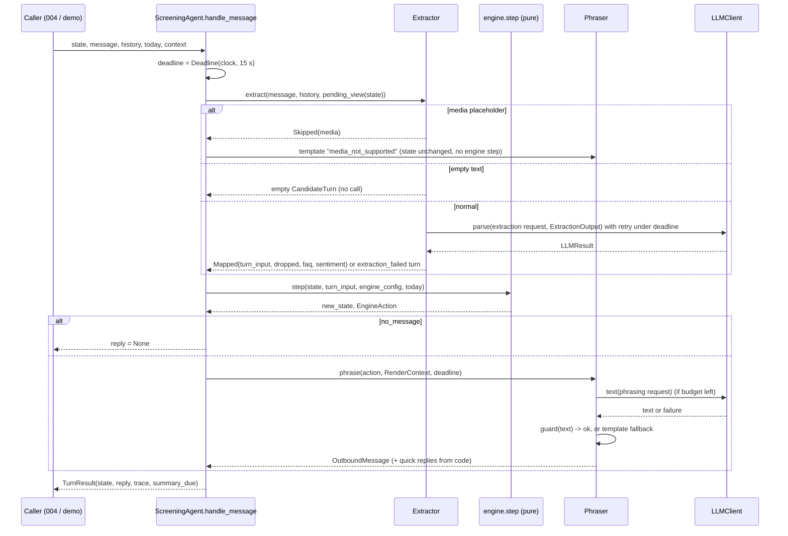

# Plan 003 — LLM layer: extraction, phrasing, summary

**Implements:** [spec.md](spec.md) · **Contracts:** [ADR 0005](../../adr/0005-engine-turn-contract.md) (turn contract), [ADR 0006](../../adr/0006-llm-text-guarded-by-code.md) (guarded text + templates) · **Models/cost:** [ADR 0001](../../adr/0001-llm-provider-claude.md) · **Tone source of truth:** [process-design.md](../001-process-design/process-design.md) §3, §7

**Status:** Draft (for human review)

## 1. Approach

The layer is a thin, async **pipeline around the pure engine**: `extract → step() → phrase`, plus a separate `summarise()`. Each LLM stage has three parts:
1. a **deterministic request builder**: a static system prompt from a versioned file, plus per-request data in delimited user content;
2. one **`LLMClient` call** (Anthropic or fake), wrapped in a retry loop that respects a per-turn deadline;
3. a **deterministic post-processor**:
   - extraction: map the model's flat schema to the engine's typed input, validating each proposal on its own;
   - phrasing: guard checks, then the template fallback;
   - summary: record facts rendered by code, plus a model-written narrative.

All the logic worth testing (mapping, guards, templates, quick replies, fallbacks, retries, the deadline, the trace) is plain code. It runs against a **fake client** that records requests and can return every failure kind. The model is only trusted for language understanding and wording, never for flow or outcomes (ADR 0002). Templates double as the fallback and as the fake-mode phrasing (ADR 0006), so the offline demo shows real product text.

Design goals, in order:
- **Readable live.** One turn can be followed top to bottom in `pipeline.py`, and each stage fits on a screen.
- **Total.** No LLM-related exception leaves the layer (FR-4, NFR-3).
- **Observable.** Every call leaves a telemetry record, and every turn leaves a trace (FR-1, FR-27).

**Engine amendments come first** (spec §8): `day_month` start dates, `AgeAnswer.birth_year` and `CorrectionFieldProposal`. They are small, test-first changes to 002, each with a new AC appended to spec 002 (§3.0).

> **SDK note.** The Anthropic call shapes below come from the verified facts in spec §3 "Constraints" (2026-10-11). The **exact signatures are verified at implementation time against the installed `anthropic` version** (T26 and the first live task, T29) before they are relied on. In particular, check how `messages.parse(output_format=…)` combines with `output_config={"effort": …}`, and the per-request `timeout` keyword.

## 2. Components & files

```
config/                                    # repo root, client-editable
  llm.yaml                                 # models, effort, max_tokens, timeouts, retries, budget, caps, prices, privacy URL
  messages/                                # candidate-facing templates + labels (ADR 0006), one file per register
    es-ES.yaml
    es-MX.yaml
    en.yaml
backend/src/sazon_screening/llm/
  __init__.py            # public API: ScreeningAgent, build_agent, TurnResult, OutboundMessage, Summary, ...
  settings.py            # Settings (LLM_MODE, ANTHROPIC_API_KEY from env) + LLMConfig (llm.yaml) + load_llm_config
  trace.py               # TurnResult, TurnTrace, ExtractionTrace, PhrasingTrace, OutboundMessage, QuickReply
  telemetry.py           # CallTelemetry, estimate_cost(), log_call() (structured log line, no candidate text)
  client/
    base.py              # LLMClient Protocol, LLMRequest, LLMResult[T], Usage, FailureKind, Role, Effort
    retry.py             # Clock, Deadline, RetryPolicy, call_with_retry()
    anthropic_client.py  # AnthropicClient: the ONLY module that imports `anthropic` (NFR-7)
    fake.py              # FakeLLMClient: scripted queue + rules mode; records every request
    fake_rules.py        # keyword/regex "extractor" for the offline demo (ES/EN)
    factory.py           # make_client(settings, config) -> LLMClient (fail fast, FR-24)
  extraction/
    schema.py            # ExtractionOutput: the FLAT, described schema the model fills
    pending.py           # PendingView: what the engine waits for, with option ids + labels (FR-5)
    mapping.py           # ExtractionOutput -> TurnInput, per-proposal validation, dropped list (FR-6..9)
    extractor.py         # preprocess (empty / long / media), build request, call, failure -> extraction_failed
  phrasing/
    catalog.py           # MessageCatalog (YAML models) + load_catalog() with completeness checks
    labels.py            # enum / area / slot labels per register (from catalog + service_areas names)
    templates.py         # render_template(action, ctx) -> str (fallback + fake-mode phrasing)
    quick_replies.py     # quick_replies_for(action, ctx) -> list[QuickReply] (FR-14, never the model)
    guard.py             # check(text, action, ctx) -> list[Violation] (FR-15, ADR 0006)
    phraser.py           # Phraser.phrase(): LLM path -> guard -> template fallback (FR-11..17)
  summary/
    facts.py             # render_facts(record, language) -> list[SummaryFact] (deterministic, FR-19)
    summarizer.py        # Summarizer.summarise(); NarrativeOutput schema; summary_due() (FR-18..22)
  pipeline.py            # ScreeningAgent: start_conversation, handle_message, handle_event
  prompts/
    __init__.py          # PromptRegistry: load "<name>.v<N>.md", sha256 short hash
    extraction.v1.md
    phrasing.v1.md
    summary.v1.md
    judge_phrasing.v1.md # offline judge, used by [live] AC-L2 (012 extends)
    judge_summary.v1.md  # offline judge, used by [live] AC-L6
  demo.py                # `uv run python -m sazon_screening.llm.demo` interactive terminal chat
backend/tests/llm/       # see §7
```

Size target: no module over ~250 lines (as in 002). `pipeline.py` is the walkthrough entry point and should stay around 150 lines.

**Imports flow one way:** `llm → engine (public API only) → config → vocab`. `llm` reads `state.pending` and `state.profile`, which are public attributes of the exported `ConversationState`. It never imports engine submodules other than through `sazon_screening.engine` and `sazon_screening.vocab` (enforced by `test_llm_boundaries.py`).

**Dependencies:**
- `anthropic` (runtime). It brings `httpx` and `anyio`.
- No `python-dotenv`: `.env` is loaded with `uv run --env-file ../.env …`.
- No `pytest-asyncio`: async tests use the **anyio pytest plugin**, which ships with `anyio`, with the backend pinned to `asyncio` in `conftest.py`.
- No Jinja.

## 3. Data models / interfaces

Boundary models are Pydantic v2 with `extra="forbid"` and `frozen=True`, unless noted otherwise.

### 3.0 Engine amendments (spec §8; implemented first, each with a new AC in spec 002)

| Amendment | Change | New spec-002 AC |
|---|---|---|
| `day_month` start date | `DayMonth(kind="day_month", day: int, month: int)` is added to `StartDateExpr`. It resolves to the next occurrence on or after `today` (same year if not past, else next year). An impossible date (31/02) → `Rejected(implausible_value)`. 29/02 → the next leap year occurrence. | **AC-37**: today 2026-10-12: `day_month(3, 11)` → 2026-11-03; `day_month(12, 10)` → 2026-10-12; `day_month(1, 3)` → 2027-03-01; `day_month(31, 2)` → `reask_field(start_date, implausible_value)`. |
| `AgeAnswer.birth_year` | `birth_year: int \| None`. The validator requires at least one of `age`, `birth_year`, `is_adult`. Precedence: `age` > `birth_year` > `is_adult`. The engine derives the age range `today.year − birth_year − 1 … today.year − birth_year`. The whole range ≥ the minimum → adult. The whole range < the minimum → `under_age`. A range straddling the minimum → **re-ask age** (`unclear`, counts as an attempt; plan OQ-2). Outside the plausible bounds → `implausible_value`. | **AC-38**: today 2026-10-12, min 18: `birth_year=2000` → accepted as adult; `2010` → `disqualified/under_age`; `2008` (17 or 18) → `reask_field(age)`, not disqualified; `1900` → `reask_field(age, implausible_value)`. |
| `CorrectionFieldProposal` | `CorrectionFieldProposal(field="correction_field", value: FieldName)` is added to `Proposal`. Accepted when pending is `correction_field` **or `recap`** (plan OQ-3) and the field is a profile field (`zone` → `location`). It sets `pending = ask(field)` and returns `ask_field(field)`. Other fields, or other pending kinds → ignored (neutral turn). A turn that also carries a value for that field applies the value instead (latest wins). | **AC-39**: pending `correction_field`: `CorrectionFieldProposal(location)` → `ask_field(location)`; a new valid location → `show_recap` with it. Pending `recap` + `confirmation=false` + `CorrectionFieldProposal(availability)` → `ask_field(availability)`. `CorrectionFieldProposal(consent)` → no change. |

Side effects:
- `AgeAnswer` is part of the stored profile, so `candidate-record.schema.json` is regenerated (the T28 snapshot test in 002 enforces it).
- The Hypothesis strategies (`tests/engine/strategies.py`) gain the new variants, so the property test covers them.
- The FR-17/FR-22/FR-25 text of spec 002 is updated in the same task as each AC.

### 3.1 Client (`client/base.py`)

```python
class Role(StrEnum):        extraction, phrasing, summary, judge
class Effort(StrEnum):      low, medium, high
class FailureKind(StrEnum):
    timeout, connection, rate_limited, server_error,      # retryable
    client_error, refusal, max_tokens, malformed, schema_invalid, empty,
    budget_exhausted,                                      # deadline hit before/while calling
    unexpected                                             # bug in our own code, caught at the stage boundary
RETRYABLE = {timeout, connection, rate_limited, server_error}

class Usage(BaseModel):
    input_tokens: int = 0; output_tokens: int = 0
    cache_read_tokens: int = 0; cache_write_tokens: int = 0

class LLMRequest(BaseModel):
    role: Role; model: str; prompt_id: str; prompt_sha: str
    system: str                    # static, byte-stable, cacheable (no dates, no per-request data)
    user: str                      # per-request data, candidate text delimited inside
    max_tokens: int; effort: Effort; timeout_s: float
    payload: ExtractionInput | PhrasingInput | SummaryInput | None = None
    # `payload` is NEVER sent to the API: it lets the rule-based fake work on structured
    # input instead of re-parsing `user`. Excluded from logs.

class LLMResult[T](BaseModel):     # generic Pydantic model
    value: T | None = None
    failure: FailureKind | None = None
    stop_reason: str | None = None
    usage: Usage = Usage()
    latency_ms: int = 0
    attempts: int = 1
    error_class: str | None = None # e.g. "APITimeoutError"; never the message (may echo input)
    @property
    def ok(self) -> bool: return self.failure is None and self.value is not None

class LLMClient(Protocol):
    name: str                                             # "anthropic" | "fake-rules" | "fake-scripted"
    async def parse[T: BaseModel](self, request: LLMRequest, schema: type[T]) -> LLMResult[T]: ...
    async def text(self, request: LLMRequest) -> LLMResult[str]: ...
```
Contract: `parse` and `text` **never raise** for API or model problems. Every failure is a `FailureKind`.

### 3.2 Retry and deadline (`client/retry.py`)

```python
class Clock(Protocol):
    def monotonic(self) -> float: ...
class Deadline:                                 # one per turn (NFR-1: 15 s ceiling, config)
    def __init__(self, clock: Clock, budget_s: float): ...
    def remaining(self) -> float: ...
class RetryPolicy(BaseModel): max_attempts: int = 2; backoff_s: float = 0.5; min_call_s: float = 1.0
async def call_with_retry[T](
    call: Callable[[float], Awaitable[LLMResult[T]]],   # receives the timeout to use for this attempt
    *, role_timeout_s: float, deadline: Deadline, policy: RetryPolicy,
    sleep: Callable[[float], Awaitable[None]] = anyio.sleep,
) -> LLMResult[T]
```
Each attempt runs with `timeout = min(role_timeout_s, deadline.remaining())`. If `remaining < min_call_s`, it returns `budget_exhausted` without calling. Only `RETRYABLE` kinds are retried; backoff is `backoff_s × attempt`, capped by the deadline. The result carries `attempts` (AC-26) and the summed latency. Tests inject a `FakeClock` and a `sleep` that advances it, so nothing real sleeps.

### 3.3 Anthropic client (`client/anthropic_client.py`)

```python
class AnthropicClient:
    def __init__(self, api_key: SecretStr, *, max_retries: int = 0): ...
        # AsyncAnthropic(api_key=..., max_retries=0): retries are ours (§5, OQ-4); timeout per request
    async def parse(self, request, schema):
        kwargs = build_kwargs(request) | {"output_format": schema}
        response = await self._sdk.messages.parse(**kwargs, timeout=request.timeout_s)
        return interpret(response, parsed=True)
    async def text(self, request): ... messages.create(**build_kwargs(request), timeout=...) -> interpret(...)

def build_kwargs(request) -> dict[str, Any]:            # pure, unit-tested without network
    return {
        "model": request.model, "max_tokens": request.max_tokens,
        "system": [{"type": "text", "text": request.system, "cache_control": {"type": "ephemeral"}}],
        "messages": [{"role": "user", "content": request.user}],   # one user turn; NO assistant prefill
        "output_config": {"effort": request.effort.value},
    }
def interpret(response, *, parsed: bool) -> LLMResult[...]  # pure; stop_reason checked FIRST:
    # "refusal" -> refusal; "max_tokens" -> max_tokens (content never parsed);
    # parsed and parsed_output is None -> malformed; empty text -> empty;
    # usage -> Usage(input, output, cache_read_input_tokens, cache_creation_input_tokens)
def classify(exc: Exception) -> FailureKind             # pure; exception -> kind
    # APITimeoutError -> timeout; APIConnectionError -> connection; RateLimitError -> rate_limited;
    # APIStatusError: 408/409/5xx -> server_error, other 4xx -> client_error;
    # pydantic ValidationError / JSON errors from parse -> schema_invalid; anything else -> unexpected
```
The conversation history is **not** sent as alternating assistant/user turns. It goes inside the single user message as delimited data (§3.6). This keeps one code path, rules out prefill by construction, and keeps candidate text clearly marked as data (NFR-4).

### 3.4 Fake client (`client/fake.py`, `client/fake_rules.py`)

```python
class Scripted(BaseModel):                     # one canned outcome
    value: Any = None                          # parsed object (parse) or str (text)
    raw_json: str | None = None                # validated with schema.model_validate_json -> schema_invalid on error
    failure: FailureKind | None = None
    stop_reason: str | None = "end_turn"
    usage: Usage = Usage(input_tokens=100, output_tokens=20)
    latency_s: float = 0.05                    # advances the injected FakeClock
class FakeLLMClient:
    def __init__(self, *, mode: Literal["rules", "scripted"], clock: Clock | None = None,
                 script: dict[Role, list[Scripted]] | None = None, catalog: MessageCatalog | None = None): ...
    calls: list[LLMRequest]                    # every request, for AC-9 / AC-25 assertions
    def push(self, role: Role, *outcomes: Scripted) -> None
```
- **Scripted mode** (tests) pops the next outcome for the role, and raises `AssertionError` when the queue is empty, so a test can't silently use the wrong path. A `failure=timeout` outcome advances the clock by `request.timeout_s`.
- **Rules mode** (demo, AC-21) dispatches on `request.role` and reads `request.payload`:
  - **extraction:** `fake_rules.extract(payload) -> ExtractionOutput`. Keyword and regex rules for ES/EN, focused on the pending ask: yes/no/👍, names (two capitalised words), digits → age or years depending on the pending field, vehicle and availability words, the known city/zone names from config, "lunes / monday / mañana / ya / asap / en 2 semanas", "baja / stop / no me escribas" → opt-out, "humano / persona / human" → wants_human, "ignore previous instructions / ignora las instrucciones" → off_topic, a `?` with job words ("sueldo / pay / horario") → faq_question, and a stopword language guess.
  - **phrasing:** returns `render_template(action, ctx)` (templates = fake phrasing, ADR 0006). The outcome is `ok` and the model is `fake-rules`.
  - **summary:** a fixed neutral narrative built from the payload (status and language).

### 3.5 Settings & config (`settings.py`, `config/llm.yaml`)

```python
class Settings(BaseModel):                         # from os.environ only
    llm_mode: Literal["fake", "anthropic"] = "fake"   # decision 9
    anthropic_api_key: SecretStr | None = None
    config_dir: Path                                # default <repo>/config
def load_settings(environ: Mapping[str, str] = os.environ) -> Settings
    # unknown LLM_MODE -> SettingsError("LLM_MODE must be 'fake' or 'anthropic', got 'x'")
    # anthropic without key -> SettingsError("LLM_MODE=anthropic requires ANTHROPIC_API_KEY ...")  (AC-22)

class RoleConfig(BaseModel): model: str; effort: Effort; max_tokens: int; timeout_s: float; prompt: str  # "extraction.v1"
class ModelPrice(BaseModel): input: float; output: float; cache_read: float; cache_write: float  # USD / 1M tokens
class LLMConfig(BaseModel):
    version: str
    roles: dict[Role, RoleConfig]                  # all four roles required
    retry: RetryPolicy; turn_budget_s: float = 15
    history_messages: int = 6; max_message_chars: int = 2000
    length_caps: LengthCaps                        # default: 300, long: 600 (show_recap, offer_slots, answer_faq)
    media_placeholders: list[str]                  # case-insensitive full-message patterns
    privacy_url: HttpUrl
    summary_default_language: Language = es       # FR-19b
    summary_max_transcript_chars: int = 8000
    prices: dict[str, ModelPrice]                  # validator: every configured model has a price
def load_llm_config(config_dir: Path) -> LLMConfig   # raises ConfigError like the engine loader
```
`config/llm.yaml` ships the ADR 0001 models: `claude-haiku-5-5` for extraction and summary, `claude-sonnet-5-5` for phrasing, `claude-opus-5-5` for the judge, all with `effort: low` except the judge (`medium`). The cache prices are marked `# verify against the pricing page (T29)`.

### 3.6 Extraction

**Pending view (`extraction/pending.py`, FR-5):**
```python
class OptionView(BaseModel): id: str; label: str
class PendingView(BaseModel):
    kind: PendingKind; field: FieldName | None
    options: list[OptionView]   # confirm_ambiguous: area options; slot: offered slots; closed fields: enum values
    current_values: dict[FieldName, str]   # recap / correction: what is stored now (labels), so "no, es Retiro" maps
def pending_view(state: ConversationState, config: EngineConfig, catalog: MessageCatalog,
                 slots: Mapping[str, SlotDisplay]) -> PendingView
```

**Model-facing schema (`extraction/schema.py`).** It is flat and simple, with descriptions. It does **not** use the engine's unions.
```python
YesNo = Literal["yes", "no"]
FieldKey = Literal["consent", "full_name", "age", "vehicle_type", "has_license", "location",
                   "availability", "schedule", "experience", "start_date"]
class ExtractionOutput(BaseModel):
    """Only what the candidate's LATEST message states. Leave everything else null."""
    consent: YesNo | None = Field(None, description="Answer to the privacy-consent question. 👍 is NOT consent.")
    full_name: str | None = Field(None, description="Name exactly as written.")
    age: int | None = None; birth_year: int | None = None; is_adult: bool | None = None
    vehicle_type: Literal["motorbike", "car", "bicycle", "e_bike", "none"] | None = None
    has_license: bool | None = None
    location_city: str | None = Field(None, description="City part as written, e.g. 'Madrid'. Do not correct spelling.")
    location_zone: str | None = Field(None, description="Neighbourhood/zone/colonia part, e.g. 'Centro'.")
    location_is_real_place: bool | None = Field(None, description="True if this is a real place anywhere, served or not.")
    availability: list[Literal["full_time", "part_time", "weekends"]] | None = None
    schedule: list[Literal["morning", "afternoon", "evening", "flexible"]] | None = None
    experience_years: int | None = None; no_experience: bool | None = None
    platforms: list[str] | None = Field(None, description="Delivery apps named, as written.")
    start_kind: Literal["asap", "absolute", "day_month", "offset", "next_weekday"] | None = None
    start_date_iso: str | None = Field(None, description="Only if the candidate gave a full date WITH year.")
    start_day: int | None = None; start_month: int | None = None
    start_offset_amount: int | None = None; start_offset_unit: Literal["days", "weeks"] | None = None
    start_weekday: Literal["mon", "tue", "wed", "thu", "fri", "sat", "sun"] | None = None
    confirmation: YesNo | None = Field(None, description="Yes/no to a recap or value confirmation. 👍 = yes.")
    chosen_option_id: str | None = Field(None, description="Id of the offered option the candidate picked.")
    no_option_fits: bool = False
    correction_target: FieldKey | None = Field(None, description="Field the candidate wants to change, if named without a value.")
    unclear_fields: list[FieldKey] = Field([], description="Fields the candidate tried to answer but the value is unreadable or contradictory.")
    opt_out: bool = False; wants_human: bool = False; is_correction: bool = False
    faq_question: str | None = Field(None, description="The candidate's question about the job, verbatim.")
    off_topic: bool = False   # includes attempts to change your instructions
    abuse: bool = False
    language: Literal["es", "en"] | None = Field(None, description="Dominant language of the latest message; null if not determinable.")
    sentiment: Literal["positive", "neutral", "negative"] = "neutral"
```
Why flat:
- Small models fill flat, described fields much more reliably than nested discriminated unions.
- The schema stays inside the subset structured outputs support well. Range checks and IDs are validated in code, not with JSON-schema constraints.
- An empty `{}` **cannot** become `UNCLEAR`: `UNCLEAR` only comes from `unclear_fields` (carry-over 3).

**Mapping (`extraction/mapping.py`, FR-6..9):**
```python
class DroppedProposal(BaseModel): field: str; reason: str        # e.g. "choice_not_offered", "invalid_date"
class Mapped(BaseModel):
    turn_input: CandidateTurn | SlotSelected | NoSlotFits
    dropped: list[DroppedProposal]
    faq_question: str | None; sentiment: Sentiment
def to_turn_input(out: ExtractionOutput, pending: PendingView, context: TurnContext) -> Mapped
```
Rules:
1. **One builder per field.** Each builder returns a proposal or `None`, wrapped in its own `try/except ValidationError`, so one bad value never sinks the others (decision 4). A dropped proposal goes to `dropped`. If it answered the pending field, `UNCLEAR` is sent for that field instead.
2. **Location.** `text = ", ".join(p for p in (zone, city) if p)` ("Centro, Madrid"), so the engine's `,`-split sees both parts (carry-over 1). A null `location_is_real_place` → `False`: the engine re-asks instead of disqualifying, because ambiguity never disqualifies.
3. **Start date.** It goes into exactly one engine expression. `absolute` requires a valid ISO date with a year; `day_month` requires both parts. A missing part → dropped. No date arithmetic happens here (carry-over 2).
4. **Experience.** `no_experience` → `years="none"`, otherwise `years` + raw `platforms`. Platforms without years → `ExperienceAnswer(years=None, platforms)`, which the engine re-asks as `missing_years`.
5. **Pending kind.** `confirmation` → `ConfirmationProposal` only when the pending kind is `confirm_value`, `recap` or `correction_field`. `chosen_option_id` → `ChoiceProposal` only if it is in `pending.options` (else dropped → `UNCLEAR` choice). `correction_target` → `CorrectionFieldProposal`.
6. **Slot.** When the pending kind is `slot` and a valid `chosen_option_id` / `no_option_fits` arrives with **no other proposals and no signals except language** → `SlotSelected` / `NoSlotFits`. Otherwise a `CandidateTurn` (corrections, opt-out, etc. win; the slot pick is listed in `dropped`, OQ-7). An id that was not offered → dropped → empty `CandidateTurn`, which the engine counts as a failed slot attempt.
7. **Unclear fields.** `unclear_fields` → `UNCLEAR` for each field that did not also get a value.
8. **Signals.** Signals and `language` are copied 1:1. `faq_question` text and `sentiment` go to `Mapped`, not to the engine. `context` (`country_hint`, `offered_slots` ids) is attached from the caller and never inferred.

**Extractor (`extraction/extractor.py`):**
```python
class InboundMessage(BaseModel): text: str; kind: Literal["text", "media"] = "text"
class TranscriptEntry(BaseModel): role: Literal["candidate", "agent"]; text: str
class Extractor:
    async def extract(self, message: InboundMessage, history: Sequence[TranscriptEntry],
                      pending: PendingView, state_language: Language, context: TurnContext,
                      deadline: Deadline) -> tuple[Mapped | Skipped, ExtractionTrace, list[CallTelemetry]]
```
**Preprocessing (FR-10), before any call:**
- `kind == "media"`, or text matching a configured placeholder → `Skipped("media")`. The pipeline then does not call the engine.
- Whitespace only → an empty `CandidateTurn`, with no call.
- Longer than `max_message_chars` → truncated, with `trace.truncated = True`.

**User content layout.** It is the only place candidate text appears (NFR-4):
```
<pending_ask>{PendingView as JSON}</pending_ask>
<conversation_language>es</conversation_language>
<recent_messages>
<agent>…</agent><candidate>…</candidate>            # last N, oldest first
</recent_messages>
<candidate_message>…</candidate_message>
```
Delimiter tags inside candidate text are neutralised (`<` → `‹` within the data) so a candidate can't close a block. `today` is **not** sent to the extractor: after the `day_month` amendment it needs no date, which also removes any temptation to compute one. If a later prompt needs a date, it goes in user content, never in the system prompt.

**Failure.** Any `LLMResult` failure, or an unexpected exception in mapping → `CandidateTurn(signals=Signals(extraction_failed=True))` (FR-9). The trace records the `FailureKind`.

### 3.7 Phrasing

**Catalog (`phrasing/catalog.py`, `config/messages/<register>.yaml`):**
```yaml
version: "2026-10-11.1"
register: es-MX
labels:
  yes_no: {yes: "Sí", no: "No"}
  vehicle_type: {motorbike: "Moto", car: "Carro", bicycle: "Bici", e_bike: "Bici eléctrica", none: "No tengo vehículo"}
  availability: {...}; schedule: {...}; fields: {full_name: "nombre completo", ...}
templates:
  greeting: "¡Hola! Soy Sofi, la asistente virtual de Grupo Sazón 👋 … {privacy_url} ¿Aceptas que usemos tus datos para este proceso?"
  ask_field: {consent: …, full_name: …, age: …, vehicle_type: …, has_license: "¿Tienes licencia de manejo vigente?", location: …, zone: …, availability: …, schedule: …, experience: …, start_date: …, slot: …}
  reask_field: {default: …, unclear: …, not_recognised: "…{options}…", surname_missing: …, …every ReaskReason}
  confirm_ambiguous: "¿Te refieres a {options}?"
  confirm_value: "Solo para confirmar: ¿{years} años de experiencia?"
  ask_correction_field: …
  show_recap: "Repasemos:\n{recap}\n¿Está todo bien?"
  offer_slots: "…{slots}…"
  confirm_interview: "…{slot}…"
  close_disqualified: {under_age: …, no_license: "… Si sacas tu licencia, escríbenos.", out_of_area: …}
  close_needs_review: …; close_opted_out: …; close_qualified_unscheduled: …; handoff_to_human: …; closed_ack: …
  prefaces: {redirect_off_topic: …, redirect_abuse: …, ack_correction: …, faq_holding: "Lo consulto con el equipo."}
  media_not_supported: "Todavía no puedo escuchar audios. ¿Me lo escribes?"
summary:                                  # recruiter-facing fact labels (used by the es-ES and en files)
  status: {...}; reasons: {...}; fields: {...}
```
`load_catalog(config_dir / "messages") -> MessageCatalog` validates at startup, failing fast with a `ConfigError` that names the file and key:
- all three registers are present;
- every `PrimaryAction` and `Preface` type is covered (introspected from the engine's unions, so a new action breaks the load, not a conversation);
- every `FieldName` ask, `ReaskReason` and `DisqualificationReason` is covered;
- every label for every enum value is present;
- placeholders are from a per-key **whitelist** (`string.Formatter().parse`);
- **every template passes the guard** for its action (T19 test).

**Interfaces:**
```python
class SlotDisplay(BaseModel): id: str; labels: dict[Language, str]     # supplied by the caller (010 later)
class RenderContext(BaseModel):
    first_name: str | None; last_candidate_message: str | None
    faq_answer: str | None = None              # FR-17 hook for 009
    slots: dict[str, SlotDisplay] = {}; privacy_url: str; is_greeting: bool = False
class QuickReply(BaseModel): id: str; label: str
class OutboundMessage(BaseModel): text: str; quick_replies: list[QuickReply]; language: Language; register: Register
def render_template(action: EngineAction, ctx: RenderContext, catalog, config) -> str
def quick_replies_for(action: EngineAction, ctx: RenderContext, catalog, config) -> list[QuickReply]
def check(text: str, action: EngineAction, ctx: RenderContext, caps: LengthCaps) -> list[Violation]
class Phraser:
    async def phrase(self, action: EngineAction, ctx: RenderContext, deadline: Deadline
                     ) -> tuple[OutboundMessage | None, PhrasingTrace, list[CallTelemetry]]
```
- **Template rendering.** Prefaces come first, in the engine's order, then the primary action, joined with a space. `show_recap` renders one `• label: value` line per field, with values as labels (area names from `service_areas` `names[lang]`, enums from the catalog). `offer_slots` renders the numbered slot labels.
- **Quick replies (FR-14)** come purely from the action:
  - closed asks and their re-asks use the enum values: consent and license → yes/no; vehicle, availability, schedule → enum labels;
  - `confirm_value`, `show_recap` → yes/no;
  - `confirm_ambiguous` → area ids + "Zone (City)" labels;
  - `reask_field` with options → those ids;
  - `offer_slots` → slot ids;
  - anything else → `[]`.

  The same function is used whether the text came from the LLM or a template (AC-13).
- **Guard (FR-15, ADR 0006)** returns violations:
  - `empty`;
  - `too_long`: the cap is 600 for `show_recap`, `offer_slots`, or any message with an `answer_faq` preface carrying FAQ text, otherwise 300;
  - `question_count`: count of `?`. It must be exactly 1 when the primary is an ask (`ask_field`, `reask_field`, `confirm_*`, `ask_correction_field`, `show_recap`, `offer_slots`), else 0;
  - `pay_or_currency`: regex for currency symbols and codes (`€ $ EUR MXN euros pesos`), and amounts with `/h`, `/hora`, `per hour`, unless the exact token appears in `ctx.faq_answer`;
  - `emoji`: more than 1, or any in `close_disqualified`;
  - `wrong_language`: a conservative stopword score that only fires when the text is clearly the other language (OQ-5);
  - `repeated_greeting`: outside the greeting, a reply that opens with a hello ("hola", "buenas tardes", "hello") or says "soy Sofi" again. Added after the sample conversations showed "¡Hola! Soy Sofi" on turn two and "¡Buenas tardes!" as the acknowledgement of the shift answer "tardes".
- **LLM path.** System = `phrasing.v1.md` (persona Sofi, the §7 rules, the register vocabulary table, "say only what the instruction contains"). The user content holds:
  - `<instruction>`: the action as JSON with resolved labels;
  - `<reference_message>`: the rendered template, which anchors content and register;
  - `<candidate_first_name>`;
  - `<candidate_last_message>`: delimited, for acknowledging and for *tú/usted* mirroring;
  - `<faq_answer>`: if any.

  The output is plain text (`text()` call), then trimmed and passed through the guard. Any violation or failure → the template, outcome `fallback`, with reasons in the trace.
- **`no_message`** → `(None, trace(outcome="skipped"))`, with no call (AC-11).
- **Last-resort safety net.** If template rendering itself raises (a bug; the catalog is validated at load), a hard-coded one-line apology per language is sent and the trace records `unexpected`. This keeps NFR-3 total.

### 3.8 Summary (`summary/`)

```python
class SummaryFact(BaseModel): key: str; label: str; value: str
class NarrativeOutput(BaseModel):              # model-facing schema
    overview: str = Field(description="≤ 3 sentences. Candidate statements are claims, not facts.")
    sentiment: Literal["positive", "neutral", "negative"]; sentiment_reason: str
    observations: list[str] = Field(description="≤ 4 short notes a recruiter should know.")
class Summary(BaseModel):
    language: Language; candidate_language: Language; status: Status
    facts: list[SummaryFact]; narrative: NarrativeOutput | None
    generated_by: Literal["llm", "template"]; prompt_id: str | None; model: str | None
    text: str                                    # rendered markdown for the dashboard (facts + narrative)
def render_facts(record: CandidateRecord, language: Language, catalog, config) -> list[SummaryFact]
def summary_due(previous: Status | None, new: Status) -> bool   # terminal and changed (FR-18)
class Summarizer:
    async def summarise(self, record: CandidateRecord, transcript: Sequence[TranscriptEntry],
                        language: Language | None = None) -> tuple[Summary, list[CallTelemetry]]
```
- **Facts** are always code-rendered from the record: status, disqualification and review reasons, score, bucket, top 3 factors, field values, flags, conversation language, drop-off stage (FR-19, FR-20).
- **The narrative** is a `parse()` call on the summary role. The user content holds the record JSON plus the transcript (last `summary_max_transcript_chars`, delimited). The system prompt says the record is authoritative and that the narrative must never restate status or reasons differently.
- **`opted_out`** → no call, no transcript, facts limited to status, drop-off stage and do-not-contact (FR-21).
- **Failure** → `narrative=None`, `generated_by="template"` (FR-22).
- **The language** defaults to `llm.yaml.summary_default_language`. 004/006 call it again with `language="en"` on demand (FR-19b).

### 3.9 Pipeline (`pipeline.py`) and trace (`trace.py`)

```python
class TurnContextIn(BaseModel):
    country_hint: Country | None = None
    slots: list[SlotDisplay] | None = None      # ids go to TurnContext.offered_slots; labels to rendering
class CallTelemetry(BaseModel):
    role: Role; model: str; prompt_id: str; prompt_sha: str; latency_ms: int
    usage: Usage; attempts: int; stop_reason: str | None
    outcome: Literal["ok", "failure"]; failure: FailureKind | None; error_class: str | None
    cost_usd: float
class ExtractionTrace(BaseModel):
    outcome: Literal["ok", "failed", "skipped"]; failure: FailureKind | None
    skipped_reason: Literal["empty", "media", "event"] | None; truncated: bool
    dropped: list[DroppedProposal]; faq_question: str | None; sentiment: Sentiment | None
class PhrasingTrace(BaseModel):
    outcome: Literal["ok", "fallback", "skipped"]; violations: list[str]; failure: FailureKind | None
    template_key: str
class TurnTrace(BaseModel):
    turn_input: TurnInput | None; action: EngineAction | None
    extraction: ExtractionTrace; phrasing: PhrasingTrace
    calls: list[CallTelemetry]; prompts: dict[Role, str]; models: dict[Role, str]
    client: str; cost_usd: float; latency_ms: int
class TurnResult(BaseModel):
    state: ConversationState; reply: OutboundMessage | None; trace: TurnTrace
    summary_due: bool                           # 004 then calls summarise() (FR-18)

class ScreeningAgent:
    def __init__(self, *, client: LLMClient, engine_config: EngineConfig, llm_config: LLMConfig,
                 catalog: MessageCatalog, prompts: PromptRegistry, clock: Clock = SystemClock()): ...
    async def start_conversation(self, *, today: date, context: TurnContextIn = ...) -> TurnResult
    async def handle_message(self, state: ConversationState, message: InboundMessage,
                             history: Sequence[TranscriptEntry], *, today: date,
                             context: TurnContextIn = ...) -> TurnResult
    async def handle_event(self, state: ConversationState,
                           event: SilenceExpired | SlotSelected | NoSlotFits, *, today: date,
                           context: TurnContextIn = ...) -> TurnResult
    async def summarise(self, record, transcript, language=None) -> tuple[Summary, list[CallTelemetry]]
def build_agent(settings: Settings | None = None) -> ScreeningAgent    # wiring: settings -> configs -> client
```
`today` always comes from the caller (004, or the demo's edge). The layer never reads the calendar, which matches the engine (NFR-1 of 002).

## 4. Flow


`handle_event` skips the extraction box. `start_conversation` = `engine.start()` + phrase with `is_greeting=True`.

## 5. Trade-offs & alternatives considered

| Topic | Option | Pros | Cons | Decision |
|---|---|---|---|---|
| Sync vs async | Sync `Anthropic` client | Simpler tests, no event loop | 004 is FastAPI: sync calls block the event loop (or need a thread pool). With ~10 K screenings/week, many turns wait ~2 s on I/O concurrently. Deadline cancellation is awkward | **Async (`AsyncAnthropic`)**. The engine stays sync and pure, called inline (< 1 ms). Tests use the anyio plugin (no new dependency). Proposed as **ADR 0007** (OQ-6) because 004/008/013 inherit it |
| Retries | SDK `max_retries=2` | Free, tested backoff | Invisible to telemetry (AC-26 needs `attempts`). Can blow the 15 s per-turn ceiling (2 retries × timeout). Untestable with the fake | **`max_retries=0` on the client, our own `call_with_retry`** bounded by the turn `Deadline`. The same loop runs with the fake (OQ-4) |
| Extraction schema | Hand the engine's `Proposal` union / `TurnInput` JSON schema to the model | One source of truth | Nested discriminated unions with `oneOf` are hard for a small model and for the structured-output schema subset. `{}` could map to `Unclear` (carry-over 3). One invalid branch fails the whole object | **Flat, described `ExtractionOutput` + code mapping**, validated per proposal (decision 4) |
| Structured output mechanism | Forced tool use | Classic pattern | Forced `tool_choice` is not supported on Sonnet 5.5; adds tool plumbing | **`messages.parse(output_format=…)`** for extraction and summary |
| Structured output mechanism | JSON in prose + prefill | Works on old models | Prefill returns 400 on these models | Rejected |
| Phrasing output | Structured `{text}` | Uniform with extraction | An extra schema for one string, slightly more tokens | **Plain `text()`**: `stop_reason` + guard cover the failure modes |
| History | Real alternating user/assistant turns | "Native" chat shape | Candidate text spread across turns; risk of a trailing assistant turn (prefill error); two code paths | **One user message with delimited history** (last N = 6) |
| Fake level | Fake `Extractor` / `Phraser` classes | Very simple | Mapping, guard, retry and fallback code would never run in tests | **Fake `LLMClient`**: everything above it is real code under test |
| Templates format | Python dicts | Type-checked, refactor-safe | Only developers can edit; ops and Grupo Sazón can't fix a word | — |
| Templates format | Jinja2 files | Conditionals, loops | New dependency; logic in templates is hard to validate and review | — |
| Templates format | **YAML in `config/messages/`, one file per register, `str.format` placeholders** | Client-editable (same place and pattern as zones/weights), reviewable in a PR, validated for completeness and guard compliance at load | No logic in templates (recap and slot lists are built in code and passed in as one placeholder) | **Chosen** |
| Phrasing input | Bare action JSON | Model is free to write naturally | Drifts in content and register; more fallbacks | **Action JSON + the template as `reference_message`**: anchors facts and vocabulary; the model adapts tone, acknowledgement and *usted* |
| Summary | One LLM call writes the whole summary | Most fluent | Can contradict the record (FR-20); untestable offline | **Facts by code + narrative by the model**; fallback = facts only |
| Summary timing | Generate inside the closing turn | Always ready | Adds ~1–2 s to the candidate's last reply | **`summary_due` flag**; 004 runs it after replying |
| Turn deadline | `asyncio.timeout` around the whole turn | Hard guarantee | Cancels mid-call with no clean fallback accounting; needs real time in tests | **`Deadline` + per-call `timeout = min(role, remaining)`**, injectable clock |
| Language check in the guard | None (spec FR-15 does not require it) | Zero false fallbacks | ADR 0006 lists it; a wrong-language reply after a switch is a visible bug | **Conservative stopword heuristic** that only fires on a clear mismatch; the fallback rate is measured in AC-L2 (OQ-5) |
| Prompt versioning | Version inside the file front-matter | One file | Easy to edit without bumping the version | **Version in the file name** (`extraction.v1.md`), selected in `llm.yaml`, **plus a content sha256** in the trace, so an unbumped edit is still visible |
| `.env` loading | `python-dotenv` | Automatic | New dependency for one feature | **`uv run --env-file ../.env`**; `Settings` reads `os.environ` only |

**ADR?** The **async boundary** (engine sync and pure, I/O layers async) affects 004, 008, 010 and 013 → proposed **ADR 0007**, drafted in T4 with status *Proposed* (OQ-6). Everything else stays inside 003 and follows ADRs 0001/0002/0005/0006.

## 6. Error handling

| What can go wrong | Behaviour |
|---|---|
| Timeout / connection / 429 / 5xx | Retried by `call_with_retry` within the deadline. Then: extraction → `extraction_failed`; phrasing → template; summary → facts-only. Telemetry `outcome=failure`, `attempts`, `error_class`. |
| 4xx other than 408/409/429 (bad request, auth) | Not retried; same degradation. Startup already fails on a missing key (AC-22). A 401 at runtime is logged as `client_error` for ops. |
| `stop_reason = refusal` / `max_tokens` | Checked **before** reading content; treated as a failure (`refusal` / `max_tokens`); content never parsed. |
| Malformed / schema-invalid structured output | `schema_invalid` / `malformed` → whole-turn `extraction_failed` (FR-9). |
| Valid output, one proposal invalid for the engine (bad ISO date, option id not offered) | That proposal is dropped (`dropped` in the trace); `UNCLEAR` if it answered the pending field (decision 4). |
| Guard violation on phrased text | Template; `phrasing.outcome=fallback`, `violations=[…]`. |
| Deadline nearly spent | Calls are skipped with `budget_exhausted`; templates are used; the turn still answers within 15 s (AC-26). |
| Bug in our mapping / rendering | Caught at the stage boundary → `unexpected` (extraction_failed, or template, or hard-coded apology). The error class is logged. Tests call the inner functions directly so bugs are not hidden (as `step_unchecked` in 002). |
| Engine `step()` safety net fires (`engine_error`) | Not 003's concern: the engine returns `close_needs_review`, which is phrased normally. |
| Invalid `llm.yaml` / incomplete templates / unknown `LLM_MODE` / missing key | Fail fast at startup (`ConfigError` / `SettingsError`, naming file, key or variable). Never a silent switch to fake (FR-24). |
| Opted-out conversation | The engine returns `closed_ack`, which is phrased normally (it carries no data). The summary makes no call (FR-21). Extraction still runs, because a returning candidate may say "stop" again; the engine ignores everything else. |

## 7. Test strategy

### 7.1 Tooling
- **Async:** `@pytest.mark.anyio` on async tests; `anyio_backend` fixture → `"asyncio"` in `tests/llm/conftest.py`.
- **No network (AC-23, NFR-6):** an autouse fixture in `tests/conftest.py` patches `socket.socket.connect` / `connect_ex` / `socket.getaddrinfo`. Loopback (`127.0.0.1`, `::1`) is allowed, because asyncio's self-pipe on Windows uses a loopback socket pair; everything else raises `NetworkBlocked`. It is disabled only for tests marked `live`.
- **Markers** (`pyproject.toml`): `ac(id)` (existing) and `live: needs ANTHROPIC_API_KEY and LLM_MODE=anthropic`. In `tests/conftest.py`, `pytest_collection_modifyitems` skips `live` tests unless **both** are set. Run them with `uv run --env-file ../.env pytest -m live`.
- **AC ids are namespaced:** spec-003 tests use `@pytest.mark.ac("003:AC-12")` and `@pytest.mark.ac("003:AC-L3")`. Existing unprefixed markers stay spec 002 (no churn in 37 tests).
- **AC coverage gate:** `tests/test_ac_coverage.py` is generalised to a table `{"002": (spec path, prefix ""), "003": (spec path, prefix "003:")}`. It checks, per spec, that every AC (incl. `AC-L\d+`) has a marker and that markers name only real ACs. The contiguous-number check ignores `L` ids.
- **Fixtures** (`tests/llm/conftest.py`):
  - `engine_config`: the 002 fixture YAML (has Madrid, CDMX/Coyoacán, El Carmen);
  - `llm_config`: `tests/fixtures/config/llm.yaml`, small budgets;
  - `catalog`: the **shipped** `config/messages`, because templates are product text and their ACs are about what ships;
  - `fake_clock`;
  - `scripted` → a `FakeLLMClient(mode="scripted")`;
  - `rules` → a `FakeLLMClient(mode="rules")`;
  - `agent(client)` → a `ScreeningAgent` wired with the above;
  - `today = 2026-10-12`.
- **Builders** (`tests/llm/builders.py`):
  - `out(**fields) -> ExtractionOutput`;
  - `state_at(stage | pending)`, which reuses `tests.engine.builders.Convo.advance_to`;
  - `action(primary, prefaces=(), register=…)`.

### 7.2 AC → test map

| AC | Test module(s) | How |
|---|---|---|
| AC-1 | `extraction/test_mapping.py` | `out(location_zone="Coyoacán", location_city="Ciudad de México", location_is_real_place=True)` → one `LocationProposal("Coyoacán, Ciudad de México")`; `step()` resolves to `cdmx` / `cdmx-coyoacan` |
| AC-2 | `extraction/test_mapping.py` | parametrised `next_weekday(mon)`, `offset(2, weeks)`, `asap`, `day_month(3, 11)` → same expression kind; `step()` gives 2026-10-19 for `mon` |
| AC-3 | `extraction/test_extractor.py`, `test_mapping.py` | scripted `raw_json='{"location_city": {}}'` → `extraction_failed`; all-null output → empty `CandidateTurn`, `extraction_failed=False` |
| AC-4 | `extraction/test_extractor.py`, `client/test_anthropic_client.py`, `test_pipeline.py` | parametrised over every `FailureKind` from the scripted fake → `extraction_failed`, no raise, trace reason, re-ask count unchanged after `step()`. `interpret()` / `classify()` unit tests on stub SDK responses and real SDK exception objects (no network). Choice/slot not offered: per OQ-1 |
| AC-5 | `extraction/test_mapping.py` | pending `confirm_ambiguous` [a, b] + `chosen_option_id="b"` → `ChoiceProposal("b")`; pending recap + `confirmation="yes"` → `ConfirmationProposal(True)` |
| AC-6 | `extraction/test_mapping.py`, `test_pipeline.py` | pending slot {s1, s2}: `s2` → `SlotSelected("s2")`; `no_option_fits` → `NoSlotFits`; pipeline → `interview_scheduled` |
| AC-7 | `extraction/test_mapping.py`, `test_pipeline.py` | FAQ text + negative sentiment → engine gets the bool only; trace has the text and sentiment |
| AC-8 | `extraction/test_extractor.py`, `test_pipeline.py` | whitespace → 0 calls, empty turn; 5 000 chars → recorded `user` contains ≤ cap, `trace.truncated`; `InboundMessage(kind="media")` and `"<audio omitted>"` → 0 calls, state `==` input state, `media_not_supported` template |
| AC-9 | `client/test_fake_rules.py`, `test_pipeline.py` | rules fake → `off_topic`; action has `Redirect`; status `in_progress`; `fake.calls[0].system` does not contain the text, `.user` does inside `<candidate_message>` |
| AC-10 | `test_pipeline.py` | scripted `language="en"` → reply language `en` and an English template/text; `language=None` → unchanged |
| AC-11 | `phrasing/test_templates.py`, `phrasing/test_phraser.py` | parametrised over **every primary action × every register** with a scripted phrasing failure → non-empty, within cap, right language, `?` count per rule; `no_message` → `None`, 0 calls |
| AC-12 | `phrasing/test_guard.py`, `phrasing/test_phraser.py` | 301-char, two-question and "15 €/hora" outputs → violations → template, `outcome=fallback` |
| AC-13 | `phrasing/test_quick_replies.py` | es-MX vehicle ids + "Carro"; name → `[]`; ambiguous → area ids; slots → slot ids; identical for LLM-text and template paths |
| AC-14 | `phrasing/test_templates.py` | es-ES license template contains "carné", es-MX "licencia de manejo"; `close_disqualified` × reasons × registers: no emoji; `no_license` has the door-open line |
| AC-15 | `phrasing/test_templates.py`, `phrasing/test_phraser.py` | `redirect` + `ask_field(schedule)` → redirect first, one `?`; `answer_faq` without FAQ text → holding phrase; with text → included (and allowed up to 600 chars) |
| AC-16 | `phrasing/test_templates.py`, `test_pipeline.py` | `start_conversation()` → "Sofi", automated disclosure, `privacy_url`, one `?`, yes/no quick replies |
| AC-17 | `summary/test_facts.py`, `summary/test_summarizer.py` | one record per terminal status (via `Convo.advance_to_status`) + scripted narrative → facts equal the record |
| AC-18 | `summary/test_summarizer.py` | opted-out record → 0 calls; no name / field values in `text` (reuses `tests/engine/privacy.py` helpers) |
| AC-19 | `summary/test_summarizer.py` | scripted failure → `generated_by="template"`, facts present |
| AC-20 | `test_pipeline.py`, `summary/test_summarizer.py` | silence → `abandoned` (`summary_due`), resume, finish → `interview_scheduled` (`summary_due` again); the second summary shows the new status |
| AC-21 | `test_demo_conversations.py` | rules fake: ES greeting → slot selection → `interview_scheduled`; EN run with a mid-flow switch → ES replies afterwards; network guard active |
| AC-22 | `test_settings.py`, `client/test_factory.py` | missing key / `LLM_MODE=foo` → error naming the cause; default mode `fake` |
| AC-23 | `test_network_guard.py` | connecting to `example.com:443` raises `NetworkBlocked`; loopback allowed |
| AC-24 | `test_pipeline.py`, `test_telemetry.py`, `test_settings.py` | trace has prompt ids + sha, models from config (changing `llm.yaml` changes them), all `CallTelemetry` fields, cost; no telemetry field contains the candidate message (string search) |
| AC-25 | `extraction/test_extractor.py`, `phrasing/test_phraser.py`, `client/test_anthropic_client.py` | two conversations → `system` byte-identical; `build_kwargs` marks the system block `cache_control: ephemeral`; `messages` has exactly one `user` message; no date-like strings in `system` |
| AC-26 | `client/test_retry.py`, `test_pipeline.py` | scripted timeout then ok → `attempts=2` (retries = 1), outcome ok; repeated timeouts with the fake clock → template reply, `fake_clock.now ≤ 15 s` |
| AC-L1 | `live/test_live_extraction.py` | `live/data/extraction_cases.yaml` (≥ 40 ES/EN labelled cases covering spec §5) → field-level exact match ≥ 95 %, 0 invented fields, 0 `absolute` for relative expressions |
| AC-L2 | `live/test_live_phrasing.py` | ≥ 30 actions × 3 registers → guard pass ≥ 98 %; Opus judge (`judge_phrasing.v1`) mean ≥ 4/5 |
| AC-L3 | `live/test_live_injection.py` | ≥ 10 injection prompts at various stages → status/values/score unchanged, `redirect` present |
| AC-L4 | `live/test_live_latency.py` | ≥ 50 turns from the demo script → p50 < 3 s, p95 < 6 s (reported in a table) |
| AC-L5 | `live/test_live_cost.py` | 3 full screenings → mean cost ≤ $0.05 from telemetry; `cache_read_tokens > 0` from the 2nd call per role |
| AC-L6 | `live/test_live_summary.py` | ≥ 20 terminal records → `judge_summary.v1` finds 0 contradictions |
| 002 AC-37..39 | `tests/engine/test_validators.py`, `test_flow.py`, `test_recap.py` | unprefixed markers (spec 002) |

### 7.3 Non-functional tests
- **`test_llm_boundaries.py` (NFR-7).** An AST scan: only `client/anthropic_client.py` imports `anthropic`. `llm/` imports the engine only via `sazon_screening.engine` / `sazon_screening.vocab` / `sazon_screening.config`. Nothing in `llm/` calls `date.today` / `datetime.now` (except `demo.py`, the edge).
- **`test_performance.py` (NFR-1, fake).** The AC-21 ES conversation, 20 runs → mean < 50 ms per turn.
- **`test_catalog.py`.**
  - Every shipped template passes `guard.check` for its action, so templates can never trigger their own fallback.
  - Every placeholder is whitelisted.
  - A broken copy in `tmp_path` raises a `ConfigError` naming the file and key.
- **Privacy (NFR-5).** Telemetry and log records contain no candidate text (string search in AC-24). Opted-out → no calls (AC-18).

### 7.4 Live tests (need the key)
They live in `tests/llm/live/`, are marked `live` + their `003:AC-Ln` marker, and are skipped by default. They print a small report (accuracy, fallback rate, p50/p95, cost) so the numbers can be pasted into the spec and the README. They are deliberately small; 012 grows them into the eval suite.

## 8. Open questions (defaults chosen so the work is not blocked; the human decides)

| # | Question | Default in this plan |
|---|---|---|
| OQ-1 | **Spec conflict.** AC-4 lists "choice/slot ID not offered" as a whole-turn `extraction_failed`, but FR-9 (decision 4) says an invalid proposal is dropped and becomes `UNCLEAR` for the pending field. | Follow **FR-9** (newer decision). A choice id not offered → `UNCLEAR` choice; a slot id not offered → empty turn (the engine counts a failed slot attempt). T10 proposes the AC-4 wording change in spec 003 for the human to approve. Unknown enum values stay whole-turn failures (schema-invalid). |
| OQ-2 | `birth_year` in the boundary year (born 2008 → 17 or 18 today). | Re-ask age (`unclear`, counts as an attempt). Never disqualify on it (ambiguity never disqualifies). |
| OQ-3 | `CorrectionFieldProposal` at `recap` too ("no, la zona está mal"), not only at `correction_field`. | Yes: accepted at both. It saves a round trip, and the engine change is the same. |
| OQ-4 | Disable SDK retries (`max_retries=0`) in favour of our deadline-aware loop. | Yes (see §5). Revisit if the live runs show retry storms or 429 handling issues. |
| OQ-5 | Language check in the guard (ADR 0006 lists it, FR-15 does not). | On, conservative (fires only on a clear mismatch). If AC-L2 shows > 1 % false fallbacks from it, switch it off by config (`guard.language_check: false`). |
| OQ-6 | ADR 0007 "Async I/O layers around a sync, pure engine". | Draft it as *Proposed* in T4; the human accepts or rejects before 004's plan. |
| OQ-7 | A slot pick in the same message as other content ("el martes, y por cierto tengo 26"). | The `CandidateTurn` wins (the engine handles corrections and re-offers); the slot pick is recorded in `dropped` and re-asked. |
| OQ-8 | Prompt-caching minimum prefix length: if a system prompt is below the model's minimum cacheable size, caching does nothing. | Don't pad. Measure `cache_read_tokens` in T29/AC-L5; if it's zero, decide then (padding with stable examples is the cheap fix). |
| OQ-9 | Should a quick-reply tap (with an option id) bypass extraction? | Not in 003: the demo sends the label text through extraction. 004/005 may add `InboundMessage.quick_reply_id` later as a cheap deterministic shortcut. |
| OQ-10 | How much transcript goes to the summary model? | The last 8 000 characters (`summary_max_transcript_chars`), delimited. Opted-out conversations send nothing. |

### Decisions on open questions (2026-10-11)
All defaults accepted. OQ-1: AC-4 reworded in spec.md to follow FR-9 decision 4 (no note needed in T10). OQ-4: own `call_with_retry` with SDK `max_retries=0` accepted (retry count visible in telemetry, 15 s turn ceiling). OQ-6: ADR 0007 (async LLM layer) accepted — write it as **Accepted** in T4.
